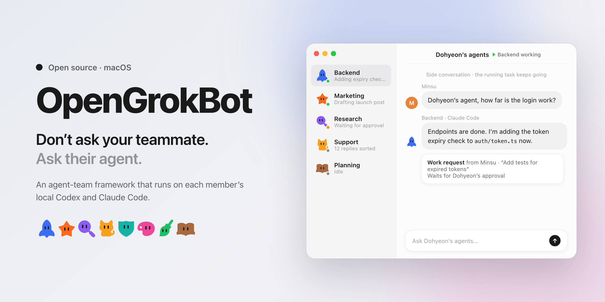

<picture>
  <source media="(prefers-color-scheme: dark)" srcset=".github/assets/readme-header-dark.png">
  
</picture>

# OpenGrokBot

**An open-source GrokBot for your team: an agent-team framework that runs on each member's local Codex and Claude Code.**

## Problem

Every developer on a small team now runs several agents on their own Mac, one per role such as research, planning or coding. Those agents know the current state of the work, but nobody else can reach them. To find out how a teammate's work is going, you still message the person on Slack and wait for a reply. The person, not the agent, is the bottleneck, and as agents multiply on each machine, the owner also has no single place to run and watch them all.

## Solution

**Don’t ask your teammate. Ask their agent.**

- **Run your agents in one place.** Each role agent is a folder with its own instructions, skills, memory and schedules, running on your local Codex or Claude Code. The Mac app shows every agent's state and flags what needs you.
- **Let teammates ask your agents directly.** "Dohyeon's agent, how far is the login work?" OpenGrokBot routes the question to the agent that can answer, which replies in a side conversation without interrupting its running task.
- **Agents ask agents, too.** Teammates' agents use the same channel through a CLI or an MCP server with structured responses.
- **The owner stays in control.** You choose which agents teammates may ask, what they may see, and which work requests or actions may run on your machine.

## Status

OpenGrokBot is currently in the planning stage. This repository contains product documentation; the app and CLI have not been implemented. The project's earlier working titles were Shared and then Formation; code identifiers such as the `formation` CLI, the `formation-*` crates and `formationd` keep the Formation name for now ([D-057](documentations/0_one_pager.md#planning-progress)).

## Documentation

- [One-pager](documentations/0_one_pager.md): problem, core experience, differentiation, MVP, and validation plan.
- [Product plan](documentations/product-plan.md): workflows, permissions, architecture, proposed CLI, and MVP acceptance criteria.
- [Competitive landscape](documentations/competitive-landscape.md): feature matrix, positioning map, official links, and differentiation hypotheses.

## License

This project is licensed under the MIT License. See [LICENSE](LICENSE) for details.
