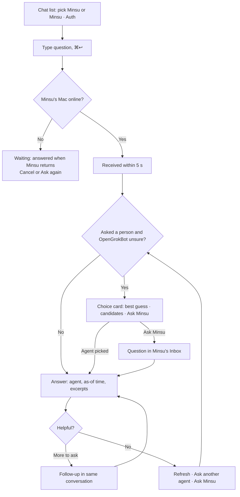
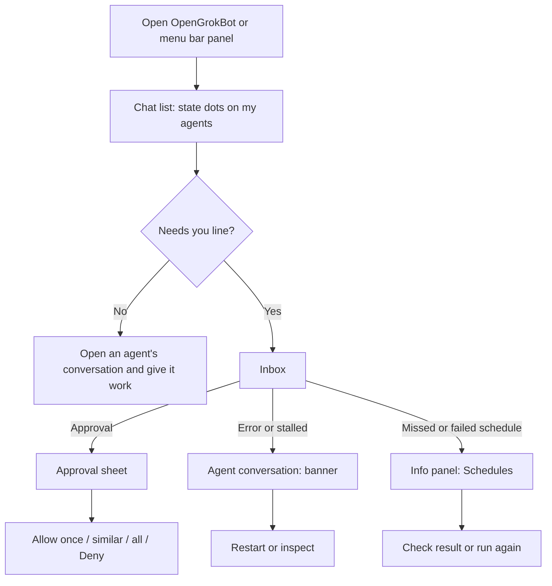
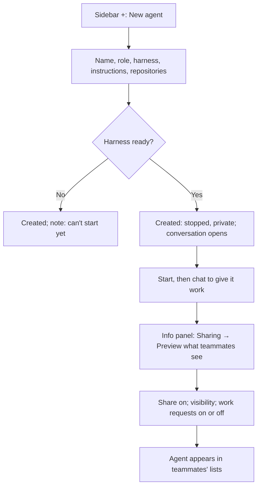
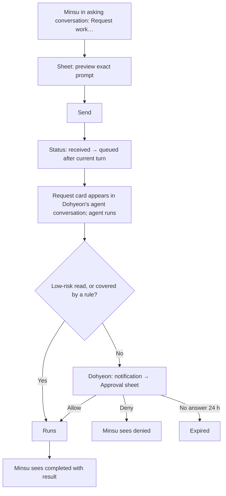
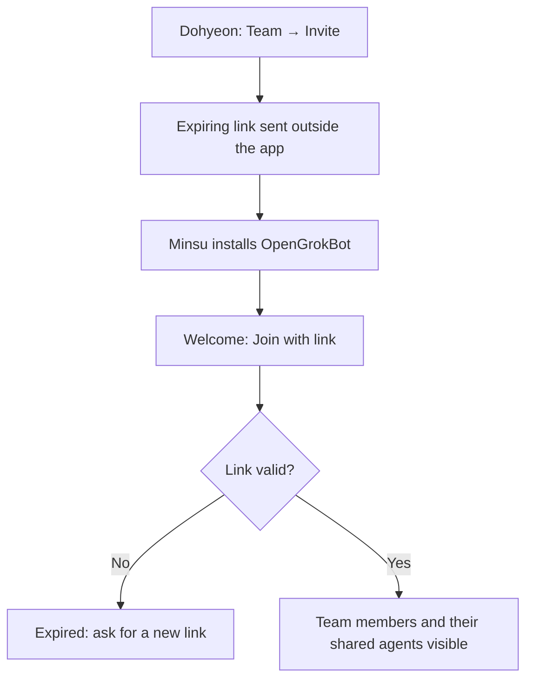
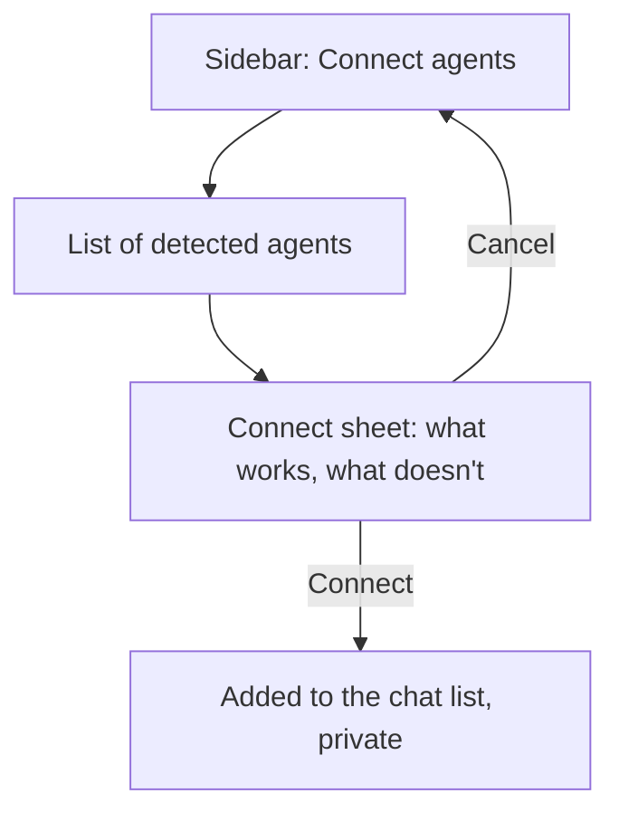
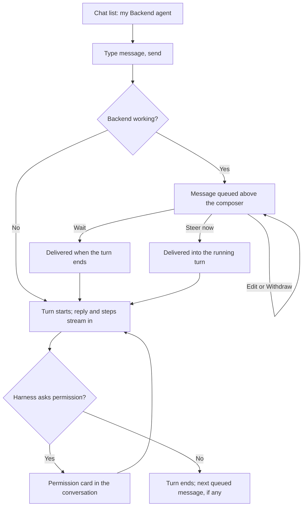

# OpenGrokBot — Screens and user flows

Rev 3 · 2026-11-09 · Based on the confirmed [product requirements](1_product_requirements_documentation.md) (Rev 2) and [user stories](2_user_stories.md) (Rev 2). Decision IDs refer to the [planning progress](0_one_pager.md#planning-progress) record. Rev 2 replaces Rev 1's six-section sidebar with an agent chat list and a new visual tone, following mockup M1 feedback (D-034 to D-039). Rev 3 draws agent avatars as open-bot-avatar characters, following mockup M2 feedback (D-042).

## App structure

OpenGrokBot is a macOS app with two surfaces (D-030):

- **Menu bar item:** a small panel for a quick check of agent state and anything that needs the owner.
- **Main window:** three columns, like a messaging app (D-034, D-037):
  - **Left sidebar:** a row of icons at the top (Inbox with a count, Team, History, Rules, New) (D-036); a "Needs you" line when something needs the owner; the chat list; and at the bottom, the owner's profile, "Connect agents," and Settings.
  - **Center:** the selected conversation, with a pill at the top naming who you are talking to. Inbox, Team, History, and Rules also open here when chosen from the top icons.
  - **Right:** an information panel for the selected agent, which can be collapsed.

```text
Main window
├── Sidebar
│   ├── Top icons: Inbox (count) · Team · History · Rules · New (+)
│   ├── "Needs you" line (only when something needs the owner)
│   ├── Chat list (most recent first)
│   │   ├── My agents                → conversation with my agent (SC-005)
│   │   ├── Teammates' agents        → asking that agent (SC-015)
│   │   └── Teammates (person-level) → asking a person (SC-015)
│   └── Profile · Connect agents · Settings
├── Center: conversation, or Inbox / Team / History / Rules
└── Right: agent information panel (SC-020)
Settings window (⌘,)
Menu bar panel
macOS notifications
```

Every member uses the same app as owner and as teammate.

### Chat list items

| Item | Avatar | Second line | Opens |
| --- | --- | --- | --- |
| My agent | Agent avatar with a state dot | Latest message or step | SC-005, conversation with my agent (FR-022) |
| Teammate's agent | Agent avatar with the owner's initial | "Minsu · " and the latest answer | SC-015, asking that agent |
| Teammate (person-level) | Person avatar | Latest answer and the agent that gave it | SC-015, asking a person (OpenGrokBot routes) |
| Connected detected agent | Agent avatar with a state dot | Latest activity | SC-005, read-only when it does not accept input |

The list is ordered by most recent activity, mixing my agents and teammates' agents (D-034). On launch, the window reopens the last conversation. When something needs the owner, a "Needs you" line at the top of the list shows the count and opens Inbox.

## Screen inventory

| SC | Screen | Purpose | Actor | Main actions | Stories / FR |
| --- | --- | --- | --- | --- | --- |
| SC-001 | Welcome and setup | First launch: check harnesses, create or join a team, allow notifications. | Any member | Create team; paste invitation; allow notifications | US-008, US-020 · FR-008 |
| SC-002 | Menu bar panel | Glance at agent states and needs-attention items without opening the window. | Owner | Open item; open main window; pause alerts | US-001, US-007 · FR-002, FR-007 |
| SC-003 | Sidebar: chat list | See every agent and conversation with its state; reach everything else. | Any member | Open a conversation; open top-icon screens; new agent or question; connect agents | US-001, US-006, US-013, US-015, US-024 · FR-002, FR-006, FR-010, FR-011, FR-022 |
| SC-004 | New agent (sheet) | Create an agent for any role and pick its harness (D-039). | Owner | Enter name, role, harness, instructions, repositories; create | US-002 · FR-001 |
| SC-005 | Conversation with my agent | Give my agent work by chat and follow its activity in the same conversation. | Owner | Send; steer now; edit or withdraw a queued message; stop; answer the harness's permission requests; review teammate requests | US-001, US-003, US-024 · FR-002, FR-003, FR-022 |
| SC-006 | Instructions & skills (sheet) | Edit the agent's instructions and skills, opened from the information panel. | Owner | Edit and save instructions; add, edit, remove skills | US-004 · FR-004 |
| SC-007 | Schedules (panel section and sheet) | Recurring tasks, their next run, and run history. | Owner | Add, edit, pause, delete a schedule | US-005 · FR-005 |
| SC-008 | Sharing (panel section) | Share or unshare; visibility; work requests; preview. | Owner | Share; set visibility; allow work requests; preview; unshare | US-009 · FR-009 |
| SC-009 | Connect detected agent (sheet) | Show what OpenGrokBot can do with a detected agent and connect it. | Owner | Connect; cancel | US-006 · FR-006 |
| SC-010 | Inbox (center) | Everything waiting for the owner: approvals, questions sent to the owner, work requests, alerts. | Owner | Open item; answer; hand to agent | US-007, US-010, US-011 · FR-007, FR-010, FR-015 |
| SC-011 | Approval (sheet) | Decide on one action from a teammate's request. | Owner | Allow once; keep allowing similar; allow all for this requester and agent; deny | US-011 · FR-015 |
| SC-012 | Rules (center) | Saved approval rules. | Owner | Edit limits; revoke | US-012 · FR-015 |
| SC-013 | Team (center) | Members, online state, invitations. | Any member | Invite; remove (team creator); open member | US-008, US-020 · FR-008 |
| SC-014 | Member's agents (center) | A teammate's shared agents, reached from Team; starting a conversation adds it to the chat list. | Teammate | Ask this member; ask an agent; request work | US-013, US-015, US-019 · FR-010, FR-011, FR-014 |
| SC-015 | Asking conversation | Ask a teammate's agent or a teammate: answers, routing choice, follow-ups, refresh. | Teammate | Ask; choose agent when unsure; follow up; refresh; ask again; request work; cancel waiting question | US-013 to US-018 · FR-010 to FR-013, FR-016 |
| SC-016 | Work request (sheet and status) | Compose a request with a preview, then follow its status. | Teammate | Send; cancel before start | US-019 · FR-014 |
| SC-017 | History (center) | Questions, answers, requests, approval decisions, results. | Owner, teammate | Filter; open; delete (own as asker, any about own agents as owner) | US-012, US-021 · FR-013, FR-020 |
| SC-018 | Settings window | Harnesses, notifications, team, language. | Any member | Locate harnesses; notification options; leave team | US-002, US-007 · FR-001, FR-007 |
| SC-019 | macOS notifications | System notifications for needs-attention events. | Owner | Click to open the related item | US-007 · FR-007 |
| SC-020 | Agent information panel (right) | The selected agent's details and settings, beside its conversation. | Owner; teammate (limited) | Collapse; open instructions and skills, schedules, sharing; show folder; mute | US-001, US-004, US-005, US-009 · FR-002, FR-004, FR-005, FR-007, FR-009 |

Interfaces without screens:

| IF | Interface | Purpose | Stories / FR |
| --- | --- | --- | --- |
| IF-001 | `formation` CLI | A teammate's agent lists members and agents, asks, requests, checks status, cancels; JSON output. | US-022 · FR-017, FR-019 |
| IF-002 | MCP server | The same operations as MCP tools. | US-023 · FR-018, FR-019 |

## Screen details

### SC-001 Welcome and setup
- **Shows:** whether Claude Code and Codex are installed and signed in; create a team or join with an invitation link; a notifications permission step.
- **Validation:** an invitation link must be valid and not expired.
- **States:** harness missing (agents using it cannot start yet; setup continues); invitation expired; success (opens the main window).

### SC-002 Menu bar panel
- **Shows:** a one-line summary ("5 agents · 2 need you"), needs-attention items, then each agent with its state.
- **States:** all clear; needs attention; offline (cannot reach the team; local agents still listed). The menu bar icon shows a dot when something needs the owner.

### SC-003 Sidebar: chat list
- **Top icons:** Inbox (count badge), Team, History, Rules, and "+" with "New agent" and "New question."
- **Needs you line:** "2 need you" with the most urgent item; click opens Inbox.
- **List item:** avatar (state dot for my agents; owner's initial for teammates' agents), name, second line, time. Selected item has a soft gray background; items needing attention show their state in the second line.
- **Bottom:** profile with online state; "Connect agents" (detected agents, SC-009); Settings.
- **States:** default; needs you; empty (no agents or conversations: "Create your first agent" and "Connect agents already running"); detecting (rows appear as agents are found).

### SC-004 New agent (sheet)
- **Inputs:** name (required, unique on this Mac); role (required, free text, any role); avatar, a character shape and color suggested from the role and changeable (D-042); harness, picked from a list showing each harness and whether it is ready (Claude Code or Codex in the first version; more can be added later, D-039); starting instructions (optional); repositories (optional, typical for coding).
- **States:** harness not ready (the agent can still be created; a note says it cannot start yet); name taken; created (opens its conversation, SC-005).

### SC-005 Conversation with my agent
- **Top pill:** agent avatar and name; state beside it.
- **Messages:** my messages in dark bubbles on the right; the agent's replies in light bubbles on the left; the agent's steps (file changed, command run) as compact rows between them, grouped and collapsible; date and time separators.
- **Cards in the conversation:** a teammate's work request delivered to this agent ("Minsu asked: add token expiry tests"), with its status and, when an action needs approval, "Review" (opens SC-011); the harness's own permission request for my work, with its choices (FR-022, proposed default 11).
- **Composer:** a large rounded box with "+" and send. While the agent works, send becomes **Stop**, and a new message shows above the composer as queued with **Steer now**, **Edit**, and **Withdraw**.
- **States:** idle; working (steps streaming); queued message; waiting for approval (card); stalled (banner: no activity for N minutes, with view and restart); error (banner with restart); stopped (start button in place of the composer); detected read-only (composer disabled with the reason); stop confirmation ("Stop after this turn" default, or "Stop now").

### SC-006 Instructions & skills (sheet)
- **Shows:** an editor for the instructions file; a list of skills with add, edit, and remove.
- **States:** unsaved changes (⌘S saves); saved ("Takes effect from the next session"); changed on disk (reload, or keep my edits).

### SC-007 Schedules (panel section and sheet)
- **Panel:** each schedule with its next run and last result; "Add."
- **Sheet:** task prompt (required); repeat (daily, weekdays, weekly, every N hours); time; run history.
- **States:** none yet; missed (ran on wake); failed (error and run again).

### SC-008 Sharing (panel section)
- **Shows:** a share switch (off by default); visibility, "Answer only" or "Answer and excerpts" (default); a work requests switch (off by default); "Preview what teammates see."
- **Unshare:** a confirmation explains that new questions and requests stop now, pending ones are canceled, and a running task continues unless stopped.
- **States:** private; shared; preview (sheet with a sample answer); unshare confirmation.

### SC-009 Connect detected agent (sheet)
- **Shows:** what was detected (harness, folder, state); which operations work and which do not, with reasons; a note that OpenGrokBot will not change the agent's own configuration.
- **States:** connectable; read-only; not supported.

### SC-010 Inbox (center)
- **Shows:** grouped items: approvals waiting, questions sent to me, work requests, alerts (error, stalled, failed or missed schedule), each with who, which agent, and how long it has waited.
- **States:** empty ("Nothing needs you"); items present.

### SC-011 Approval (sheet)
- **Shows:** requester and their agent, purpose, target agent, the exact command or file change in monospace, and what each choice covers.
- **Choices:** Allow once · Keep allowing similar… (shows the rule) · Allow all for this requester and agent · Deny.
- **Keyboard:** no choice is triggered by Return; Esc asks before denying.
- **States:** expiring soon; expired.

### SC-012 Rules (center)
- **Shows:** each rule's requester, agent, program and allowed arguments, folder, limits, expiry, and use count; the always-allowed file reads.
- **States:** none yet.

### SC-013 Team (center)
- **Shows:** members with online state; "Invite" (expiring link); "Remove" for the team creator; "View agents" per member.
- **States:** only me; invitation created.

### SC-014 Member's agents (center)
- **Shows:** the member's online state, "Ask Minsu" (person-level), and their shared agents with role, harness, state, last activity, and whether they accept work requests. Starting a conversation adds it to the chat list.
- **States:** online; offline (questions wait); no shared agents.

### SC-015 Asking conversation
- **Top pill:** the agent ("Minsu · Auth") or the person ("Minsu"); for a person, a note that OpenGrokBot picks the agent.
- **Answer bubble:** the answer; a footer with the agent that answered and "As of 10:42"; "Possibly out of date" when the source is older than 1 hour; excerpts, collapsible, when visibility allows; actions "Refresh," "Ask another agent," "Ask Minsu," "Request work…"
- **Routing unsure:** one card with the best-guess agent first, other candidates, and "Ask Minsu."
- **States:** new; received (within 5 seconds); answering; answered; unsure; possibly out of date; waiting because the owner is offline (cancel or ask again); sent to owner; no longer shared (composer disabled); error (retry).

### SC-016 Work request (sheet and status)
- **Compose:** target agent; request text or selected messages from the conversation; a preview of the exact prompt.
- **Status:** received, waiting for approval, queued, running, then completed, denied, failed, canceled, or expired; "Cancel" while not started.
- **States:** agent does not accept requests.

### SC-017 History (center)
- **Shows:** filters for questions, requests, approvals, results; each entry opens its detail.
- **Delete:** askers delete their own questions; owners delete any about their agents; confirmation required.
- **States:** empty; no matches.

### SC-018 Settings window
- **Tabs:** General (launch at login, menu bar item, language: follows the system, Korean or English, D-033), Harnesses (Claude Code and Codex location and sign-in status), Notifications (which events alert), Team (team name, leave team).

### SC-019 macOS notifications
- Only for needs-attention events (FR-007). Clicking opens the related conversation or approval.

### SC-020 Agent information panel (right)
- **For my agent:** avatar, name, role, harness, state and last activity; folder with "Show in Finder"; cards that open Instructions & skills (SC-006), Schedules (SC-007), and Sharing (SC-008); teammates' recent questions about this agent; mute alerts.
- **For a teammate's agent:** role, harness, state, last activity, whether it accepts work requests, and "Request work…"; nothing private.
- **For a person:** their shared agents.
- Collapses with a toolbar button; the conversation then takes the full width.

## Main flows

### Flow 1 — Ask about progress (US-013, US-014, US-016, US-017)



### Flow 2 — Owner starts the day (US-001, US-007, US-011)



### Flow 3 — Create and share an agent (US-002, US-009)



### Flow 4 — Request work and approve (US-019, US-011)



### Flow 5 — Join a team (US-008, US-020)



### Flow 6 — Connect a detected agent (US-006)



### Flow 7 — Give my agent work by chat (US-024)



### Back navigation, interruption, and recovery

- Sheets close with Esc (the approval sheet asks first) and leave nothing half-created.
- The window reopens on the last conversation, with the information panel open or closed as it was.
- Queued messages, waiting questions, and request statuses survive app restarts and network drops (NFR-007).
- Access removed while a teammate is viewing: the conversation shows "This agent is no longer shared," and the composer is disabled.
- Private agents never appear in teammates' lists or in routing.

## Visual direction and design system

**Direction (D-038, with D-031):** bright, airy, and rounded, like the Reason and Grok Bot apps the user showed: a soft gray sidebar, a near-white conversation area, a centered pill naming who you are talking to, light bubbles for agents and dark bubbles for me, black primary buttons, and a large rounded composer. Calm and simple, fast to respond (feedback within 100 ms of any action), and keyboard-first. OpenGrokBot uses its own avatars and assets, not those products' characters or logos.

**Foundation:** native macOS window, menu, keyboard, sidebar, and Settings conventions from the [Apple Human Interface Guidelines](https://developer.apple.com/design/human-interface-guidelines/), styled in the tone above. One deliberate departure: primary buttons and my message bubbles are monochrome (black in light mode, white in dark mode) instead of the system accent color; the system accent still marks keyboard focus. The production stack is decided in the tech spec.

| Token | Light | Dark |
| --- | --- | --- |
| Window and conversation background | #FCFCFC | #161618 |
| Sidebar background | #F5F5F5 | #1C1C1E |
| Selected list item | #E9E9EB | #2C2C2E |
| Agent bubble | #F0F0F0 | #2A2A2C |
| My bubble and primary button | #1A1A1A, white text | #F2F2F2, black text |
| Secondary button | #EFEFEF | #2C2C2E |
| Text primary / secondary / tertiary | #1A1A1A / 60% / 35% | #F5F5F7 / 62% / 34% |
| Separator | 8% black | 10% white |
| State colors (dots and icons) | Working green, waiting for approval orange, stalled yellow, error red, idle and stopped gray; always paired with a text label | Same hues, dark-mode values |

| Token | Value |
| --- | --- |
| Theme | Follows the macOS light or dark setting (D-031). |
| Typography | SF Pro and Apple SD Gothic Neo (system fonts). Body 14 pt; messages 15 pt; list names 14 pt semibold; second lines 13 pt secondary; pill title 15 pt semibold; screen titles 20 pt semibold. SF Mono for commands and paths. |
| Radii | List items 12 pt; bubbles 18 pt; cards 14 pt; sheets 16 pt; composer 24 pt; buttons and pills fully rounded. |
| Spacing | 4 pt base; 8, 12, 16, 24 for gaps; 20 pt conversation padding. |
| Avatars | Agents: an [open-bot-avatar](https://github.com/DominikScholz/open-bot-avatar) v1 character (a soft object silhouette with two eyes, MIT) in one flat color, 40 pt in the list and 28 pt in the pill; shape and color are picked per agent, with a suggestion from the role (D-042). A working agent's avatar moves gently; Reduce Motion stops it. People: 36 pt circle with an initial. Badges: 12 pt state dot (my agents) or 16 pt owner initial (teammates' agents) at the lower right. |
| Window | Default 1180 × 740 pt; minimum 900 × 560 pt; the information panel is 300 pt and collapsible. |
| Motion | Minimal; respect Reduce Motion. |

**Components and states:**

- Top icon button: default, hover, with count badge.
- Chat list item: default, hover, selected, needs attention.
- Pill header with avatar and state.
- Agent avatar: still, working (gentle motion), with state dot or owner initial; avatar picker (shape and color).
- Agent bubble, my bubble, step row (collapsed or expanded), date separator.
- Cards in a conversation: teammate request, permission request, routing choice, waiting, error.
- Queued message chip: Steer now, Edit, Withdraw.
- Composer: idle, agent working (Stop), disabled with reason.
- Information panel cards: details, Instructions & skills, Schedules, Sharing, teammate questions.
- Buttons: primary (black pill), secondary (gray pill), destructive (red text), plain; disabled; focus ring.
- Switches, two-option segmented control, text editor, sheets, alerts, empty states, error banners.

**Accessibility:** every control has a VoiceOver label; full keyboard navigation (Tab, arrows, Esc); shortcuts for main actions (⌘N new question, ⇧⌘N new agent, ⌘K to jump to a conversation, ⌘↩ send, ⌘. stop, ⌘S save, ⌘, settings); state never conveyed by color alone; text contrast meets WCAG AA in both themes.

## Reference research

Checked 2026-11-09. These are visual and interaction references, not code to adopt.

| Source | Use | Notes |
| --- | --- | --- |
| Screenshots of the Reason app and the Grok Bot app supplied by the user (2026-11-09) | Layout (agent chat list, conversation, right panel) and tone (D-034, D-038). | Visual reference only; their avatars, characters, and logos are not reused. |
| [Apple Human Interface Guidelines](https://developer.apple.com/design/human-interface-guidelines/) | Window, menus, keyboard, sidebars, notifications, dark mode. | Platform guidance; the monochrome primary color is a deliberate departure noted above. |
| `macos-design-guidelines` skill in `.claude/skills/` ([source](https://github.com/ehmo/platform-design-skills), MIT) | Checklist: shortcuts for all actions, notifications only for events needing action, system fonts, dark mode, badge counts. | Committed to this repository. |
| `swiftui-expert-skill` macOS scene references ([source](https://github.com/avdlee/swiftui-agent-skill), MIT) | Menu bar panel (`MenuBarExtra`, window style) and Settings window as standard scenes. | For the tech spec. |
| Linear, Raycast, Claude desktop app | Earlier references (D-031): speed, keyboard, conversation layout. | Inspiration only. |
| [open-bot-avatar](https://github.com/DominikScholz/open-bot-avatar) (MIT) | Agent avatars (D-042): a JSON definition (one body path in a 100 × 100 box plus eye placement) with a dependency-free renderer that adds volume, gaze, blinking, and moods. | Used. The mockup embeds twelve gallery shapes with the MIT notice and draws them flat; checked 2026-11-09 (308 stars, MIT, no releases yet). |
| [OpenAvatar](https://github.com/Enconvo/OpenAvatar) ([gallery](https://openavatar.enconvo.com)) | 3D agent avatars that react to agent and user states (listening, thinking, speaking, working), rendered with three.js. | Not used in the mockup. Candidate for a larger, animated agent presence; code Apache-2.0, spec and examples CC BY 4.0; very early on 2026-11-09 (5 commits, no releases). Decide in the tech spec. |

No third-party UI template is proposed: native controls cover every screen, and the HTML mockup imitates them.

## Mockup review record

| Revision | Artifact | Status | Content hash | Presented | Feedback |
| --- | --- | --- | --- | --- | --- |
| M1 | mockups/index.html (replaced by M2) | changes requested | 1b6cbf8f193d | 2026-11-09 | Agent chat-list sidebar like Reason and Grok Bot; chat with own agents; icons at the top of the sidebar; right information panel; follow their overall tone (D-034 to D-038). |
| M2 | mockups/index.html (replaced by M3) | changes requested | aae05d425df7 | 2026-11-09 | Use agent avatar libraries such as open-bot-avatar and OpenAvatar (D-042). |
| M3 | [mockups/index.html](mockups/index.html) | approved | 3f2d91bf1917 | 2026-11-09 | Approved 2026-11-09: "승인" ("Approved"), together with document 3 Rev 3. Committed as 24516c7 on main. |

Open the file in a browser. A review bar (English, not product UI) selects the screen, its state, the theme, and the UI language (Korean or English, D-033). Links open a screen and state directly.

| Screen | States covered |
| --- | --- |
| [SC-001](mockups/index.html#SC-001/default) Welcome and setup | default, harness-missing, invite-expired |
| [SC-002](mockups/index.html#SC-002/default) Menu bar panel | default, all-clear, offline |
| [SC-003](mockups/index.html#SC-003/default) Sidebar: chat list | default, empty, detecting |
| [SC-004](mockups/index.html#SC-004/plus-menu) New agent | plus-menu, default, harness-not-ready, name-taken |
| [SC-005](mockups/index.html#SC-005/working) Conversation with my agent | working, idle, queued, permission, approval, stalled, error, stopped, detected, stop-confirm |
| [SC-006](mockups/index.html#SC-006/default) Instructions & skills | default, unsaved, changed-on-disk |
| [SC-007](mockups/index.html#SC-007/panel) Schedules | panel, sheet, missed, failed, empty |
| [SC-008](mockups/index.html#SC-008/shared) Sharing | shared, private, preview, unshare-confirm |
| [SC-009](mockups/index.html#SC-009/connectable) Connect agents | connectable, read-only, not-supported |
| [SC-010](mockups/index.html#SC-010/default) Inbox | default, empty |
| [SC-011](mockups/index.html#SC-011/default) Approval | default, keep-similar, expiring, expired, deny-confirm |
| [SC-012](mockups/index.html#SC-012/default) Rules | default, empty |
| [SC-013](mockups/index.html#SC-013/default) Team | default, only-me, invite |
| [SC-014](mockups/index.html#SC-014/online) Member's agents | online, offline, no-shared |
| [SC-015](mockups/index.html#SC-015/answered) Asking conversation | answered, new, received, answering, unsure, stale, offline-waiting, sent-to-owner, unshared, error |
| [SC-016](mockups/index.html#SC-016/compose) Work request | compose, status, not-accepted |
| [SC-017](mockups/index.html#SC-017/default) History | default, delete-confirm, empty-filter |
| [SC-018](mockups/index.html#SC-018/general) Settings | general, harnesses, notifications, team |
| [SC-019](mockups/index.html#SC-019/approval) macOS notification | approval, error |
| [SC-020](mockups/index.html#SC-020/my-agent) Agent information panel | my-agent, teammate-agent, person, collapsed |
| [IF-001](mockups/index.html#IF-001/default) CLI | sample session |
| [IF-002](mockups/index.html#IF-002/default) MCP server | tool list and sample call |

**M2 inspection evidence (2026-11-09):** (M3 changes only the avatars; its own evidence follows.)

- Script syntax checked with `node --check`.
- All 81 screen states rendered in headless Chrome in both languages with no script exceptions, each opening in its requested state.
- Screenshots reviewed for 14 views across light and dark themes and both languages: SC-001, SC-003 (both themes), SC-004, SC-005 (working and queued), SC-007, SC-008, SC-009, SC-010, SC-011, SC-015 (answered and unsure). One defect fixed: the sidebar profile picked up the chat-bubble style through a shared class name.
- 26 click-through checks passed in headless Chrome (corrected from an earlier count of 30, which included 4 informational checks; 6 informational checks, such as the panel collapsing and the harness picker switching, also passed) over the remote debugging protocol, with no exceptions: top icons to Inbox, approval with Esc and deny, chat list to a teammate's agent, a person, and my agent; the ask flow (received → answering → answered); choosing the best-guess agent; sending while working (queued), Steer now, Stop with confirmation; collapsing and reopening the information panel; the + menu and new-agent sheet with the harness picker; Connect agents; the menu bar panel; Team to an offline member; unsharing; theme and language switching.

**M3 inspection evidence (2026-11-09):** script syntax checked; all 81 states rendered in both languages with no script exceptions; screenshots reviewed for SC-005 (light), SC-015 unsure (dark), SC-004 with the avatar picker, and SC-009 Connect agents (English); the same 26 click-through checks passed, with no exceptions.

**Not verified:** rendering on an actual Mac display; VoiceOver; shortcuts the browser reserves (⌘N, ⇧⌘N, ⌘K), shown only as hints; the minimum window size (only the default 1180 × 740 window is shown).

**Sources and attribution:** layout and tone follow the Reason and Grok Bot screenshots the user supplied (D-034, D-038), with OpenGrokBot's own app mark and role glyphs; agent avatar shapes come from the open-bot-avatar gallery (MIT, notice included in the mockup source); none of those products' characters, logos, or assets were copied. macOS conventions follow the Apple Human Interface Guidelines and the repository's `macos-design-guidelines` skill (MIT). Icons are simple original SVGs. The fake macOS menu bar uses a neutral circle instead of the Apple logo. System fonts only; no external resources are loaded.
