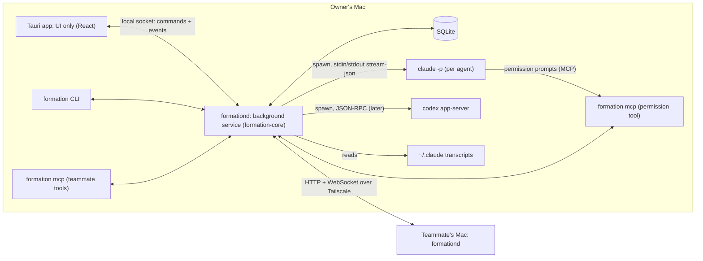

# Formation — Technical specification

Rev 3 · 2026-11-09 · Based on the confirmed [product requirements](1_product_requirements_documentation.md) (Rev 2), [user stories](2_user_stories.md) (Rev 2), and [screens and flows](3_screen_list_and_user_flows.md) (Rev 3) with the approved [mockup M3](mockups/index.html). Decision IDs refer to the [planning progress](0_one_pager.md#planning-progress) record. Rev 2 sets the minimum macOS version to 13 (D-047). Rev 3 moves the core out of the app into a background service, because agents are harness sessions that outlive the app (D-048).

## Context and constraints

- **Product:** a macOS app that runs role agents on Claude Code and Codex, and lets a team of four ask each other's agents (one-pager).
- **Existing code:** none. The repository holds planning documents, the mockup, five macOS-related skills under `.claude/skills/`, and repository conventions (`AGENTS.md`, issue and PR templates, a documentation link check).
- **Builders:** three developers and one designer, each working through a coding agent; same-day first use is the goal (D-020). Running cost has no limit.
- **Integration:** Formation launches and talks to the Claude Code and Codex CLI processes directly; it does not use the Claude Agent SDK (D-043). Claude Code comes first (D-005).
- **Team network for the MVP:** a Tailscale private network (D-045).
- **Agents outlive the app:** an agent is a Claude Code or Codex session; the app is only an interface to it. Quitting the app never stops agents (D-048).
- **Build first:** Formation is built as its own app; extending existing products may come later (D-044, reading not yet confirmed).

## Technology choices

| Area | Choice | Rationale | Status |
| --- | --- | --- | --- |
| App framework | **Tauri 2** | The approved mockup is HTML and CSS and carries over; the designer can work in CSS through an agent; one Rust core serves the app, CLI, and MCP server; tray, notifications, and launch at login are supported on macOS; much lighter than Electron. Swift was the more native alternative. | Chosen by the user, 2026-11-09 (D-041) |
| Background service | `formationd`, a Rust binary bundled in the app (`Contents/MacOS/formationd`, next to the app's executable) and registered by the app as a per-user launchd LaunchAgent: the app writes `~/Library/LaunchAgents/<app identifier>.formationd.plist` with `RunAtLoad` and `KeepAlive`, and bootstraps it in the `gui/<uid>` domain with `launchctl`. It re-registers only when the plist changes or the service is not loaded, so opening the app never restarts a running formationd. SMAppService was the alternative; it needs the app bundle, and the team runs unbundled dev builds. formationd starts at login and keeps running when the app quits. | Harness sessions need a parent that holds their stdin and stdout and keeps answering teammates while the app is closed (D-048). | Registration built in TASK-009 |
| Core language | Rust (stable, edition 2021 or later), tokio | Process supervision, JSON streaming, networking, and the policy engine in one place; shared by app, CLI, and MCP server. | Follows from Tauri |
| UI | React with TypeScript, Vite | Most familiar to coding agents; maps the mockup's components directly. | Proposed |
| UI foundation | Plain CSS with the approved design tokens as CSS variables, plus [Radix UI](https://www.radix-ui.com/) primitives for dialogs, menus, popovers, switches, and tabs | Keeps the mockup's styling as is and gives accessible behavior (focus, keyboard, screen readers) without a second visual system. shadcn/ui was considered; it would add Tailwind on top of tokens the designer already has in CSS. | Proposed; confirm in review |
| Local storage | SQLite (via `rusqlite` or `sqlx`) in `~/Library/Application Support/Formation/` | Questions, requests, rules, and activity are kept until deleted (D-029); a single local file per Mac. | Proposed |
| Peer transport | Plain HTTP and WebSocket over the tailnet, JSON messages | Tailscale already encrypts and authenticates the link (WireGuard), so the MVP adds no TLS layer of its own. | Proposed (D-045) |
| Identity | Tailscale WhoIs for "which machine and Tailscale user is calling," bound at join time to the member's GitHub account (D-046) | WhoIs answers come from the WireGuard peer and cannot be forged by headers; GitHub gives each member a stable, recognizable identity. | Proposed |
| MCP server | Official Rust SDK [`rmcp`](https://github.com/modelcontextprotocol/rust-sdk), stdio transport | Same crate set as the core. | Proposed |
| Localization | `i18next` with Korean and English bundles; follows the macOS language, overridable in Settings (D-033) | | Proposed |
| Agent avatars | [`open-bot-avatar`](https://github.com/DominikScholz/open-bot-avatar) package (MIT): definitions plus its renderer, including live motion and moods (D-042). OpenAvatar (3D) is deferred. | The mockup already uses its shapes; the package renders volume, gaze, and blinking. | Proposed |
| Minimum macOS | macOS 13 Ventura | Chosen by the user; within Tauri 2's supported range. Test on macOS 13 and the newest release. | Chosen by the user, 2026-11-09 (D-047) |
| Distribution (MVP) | Each member builds from source (`pnpm tauri build`) or runs the dev build | No signing account needed today. | Proposed; Developer ID signing, notarization, and an updater come before wider release |

### Starter

| Candidate | Source | Checked | Use | License | Decision |
| --- | --- | --- | --- | --- | --- |
| `create-tauri-app`, React + TypeScript template | [Tauri docs: Create a Project](https://v2.tauri.app/start/create-project/) | 2026-11-09 (page updated 2026-11-05) | Official scaffold for a Tauri 2 app with a React + TypeScript frontend | MIT or Apache-2.0 | **Selected.** Run `pnpm create tauri-app`, choose TypeScript, React, TypeScript. Verify at scaffold time that the template uses Vite (the docs page does not say). |
| No starter (manual setup) | Same page, manual setup section | 2026-11-09 | — | — | Not needed; the official scaffold is small. |

Adaptation: add the Rust workspace crates listed under [Code layout](#code-layout), the M3 tokens as CSS variables, Radix primitives, i18next, and `open-bot-avatar`. Remove the template's sample greet command.

## System overview



- **formationd** runs formation-core as a background service. It owns the harness processes, policy, the request queue, the peer server, and storage. "The core" below means formationd.
- **The Tauri app is an interface.** It connects to formationd over a local socket, shows its state, and sends commands. Quitting the app (⌘Q) leaves formationd and every agent session running; teammates can still ask. Stopping an agent is always an explicit action (FR-003). Stopping formationd itself stops every agent, so it is a CLI action (`formation daemon stop`, which asks for confirmation); the first version adds no screen for it, keeping the approved screens unchanged.
- **Alerts while the app is closed:** formationd keeps needs-attention items; when one arrives and the app is not running, formationd opens the app hidden in the menu bar so the macOS notification can show (proposed; verify).
- **The CLI and MCP server** are one `formation` binary that talks to formationd over the same local socket. If formationd is not running, the CLI starts it through launchd, or reports that it cannot.
- **Answers to teammates are produced on the owner's Mac,** in a side conversation forked from the agent's session (see [Ask pipeline](#ask-pipeline)).

## Claude Code integration (first harness)

All flags below are from the [Claude Code CLI reference](https://code.claude.com/docs/en/cli-reference) (checked 2026-11-09).

| Need | How | PRD |
| --- | --- | --- |
| Run an agent and chat with it | One long-lived process per running agent: `claude -p --input-format stream-json --output-format stream-json --verbose --include-partial-messages --replay-user-messages --session-id <uuid>` started in the agent's folder. The core writes user messages as JSON lines to stdin and reads events from stdout. | FR-003, FR-022 |
| Queue while working | Messages written to stdin while a turn runs stay queued and start the next turn (the `--max-turns` entry documents queued stdin messages starting new turns). The UI shows them as queued until the replayed user message arrives. | FR-022 |
| Steer now | Assumed: delivering a queued message into the running turn. Not documented for print mode; verify in the integration proof. Fallback: Stop the turn, then send the message first. | FR-022 |
| Stop | Send an interrupt on stdin if supported; otherwise SIGINT to the process, then restart it with `--resume <id>`. Verify. | FR-003 |
| Restart and continue | `claude -p ... --resume <session-id>`. | FR-003 |
| Owner's own permission prompts | `--permission-prompt-tool mcp__formation__permission` with `--mcp-config` pointing at `formation mcp --permission`. The tool forwards each prompt to the core, which shows it in the conversation (proposed default 11) and returns the owner's answer. | FR-022 |
| Teammates' work requests | Same permission tool. Requests from teammates run in forks with a per-request policy context; file isolation and how results reach the owner are open (#14). formationd passes `FORMATION_RUN_ID` to each run, permission server and hook; the permission tool has no session ID in its input. The core answers prompts from saved rules and the always-allowed reads (D-028), otherwise it raises an approval (SC-011). | FR-014, FR-015 |
| Defense in depth | Inject a `PreToolUse` hook through `--settings` that asks the core before every tool call, so a harness auto-approval path cannot skip Formation's policy (NFR-004). Verify which tool calls reach the permission tool and which reach only hooks. | NFR-004 |
| Agent instructions and skills | The agent folder's `AGENTS.md` is canonical; `CLAUDE.md` contains one line importing it (`@AGENTS.md`), and skills live in `.claude/skills/`. Codex reads `AGENTS.md` natively. | FR-001, FR-004 |
| Read a session conversation | Transcript files (`.jsonl`) under `~/.claude/projects/`; `--resume` also accepts a transcript path. | FR-012 |
| Detect sessions started elsewhere | Scan transcript folders for recent activity. Live-process detection (for example `~/.claude/sessions/<pid>.json`, used by Reason Network) is undocumented; treat as best effort and label states "unknown" when unsure. Skip sessions Formation created as forks: every fork writes a full transcript copy (`<fork-id>.jsonl`) into the same project folder (TASK-006). | FR-006 |

**Codex (second harness):** launch `codex app-server` and speak its JSON-RPC protocol (thread, turn, and approval requests), per the [Codex App Server docs](https://learn.chatgpt.com/docs/app-server) referenced in the product plan. Verify the protocol and approval hooks before building it.

## Ask pipeline

1. A question arrives (UI, CLI, MCP, or a peer) with the asker's identity, target (person or agent), and question text.
2. **Access check** on the owner's Mac: the asker is a team member; the target agent is shared (D-026); otherwise reply `agent_not_shared`.
3. **Routing** (person-level only, FR-010): score each shared agent from its role, the first lines of `AGENTS.md`, and recent session text. The scoring step is itself a short Claude Code call with tools disabled (`--tools ""`) and the same isolation flags as step 4. If the top score is below a threshold or close to the second, return the choice prompt (D-027).
4. **Answer:** in the agent's folder, run `claude -p --resume <agent-session> --fork-session --tools "" --safe-mode --setting-sources "" --strict-mcp-config --disable-slash-commands --system-prompt-snapshot off --append-system-prompt <answer prompt> --output-format stream-json`. The answer prompt requires: answer only from the conversation, say what the conversation does not establish, and list the messages used. The question goes on stdin after a short lead-in, never in argv, and the parent's `CLAUDE*` environment variables are cleared. If the CLI's `init` event lists any tool, stop the run. The fork never alters the original session, and with no tools it cannot read or write files (NFR-002, D-024).
   - The isolation flags keep the agent folder's `CLAUDE.md`, the owner's hooks and MCP servers, and slash commands out of the fork. Without them, `CLAUDE.md` shows up in answers, hooks run on every fork, a question starting with `/` runs as a command, and the answer prompt is ignored on resume. `--bare` is not an option: it fails under a subscription login. Measured with claude 2.1.319 in TASK-006.
   - Known limits for TASK-019: content already recorded in the transcript, such as hook output and the owner's account email, still reaches the fork, so answers need masking or a sanitized copy (`--resume` accepts a path). A fork taken during a running turn sees the owner's newest message as unanswered. Fork transcripts must be tracked and deleted.
5. **Post-processing:** attach `as_of` (timestamp of the newest transcript entry used), mark `possibly_stale` if older than 1 hour, keep excerpts only if the agent's visibility allows (D-025), and mask secret-like strings (NFR-003).
6. Reply to the asker; store the question and answer on both Macs (D-029). Follow-ups continue the forked session.

## Data model

Stored in SQLite on each member's Mac. Times are UTC in storage and shown in local time. IDs are UUIDv7 strings.

| Entity | Key fields | Rules |
| --- | --- | --- |
| `member` | id, github_login, display_name, tailscale_login, tailscale_node, joined_at, role (`creator` or `member`), removed_at | Unique `github_login`; removal ends access at once (FR-008). |
| `invitation` | id, code, created_by, expires_at, used_by, used_at | Expires; single team. |
| `agent` | id, slug, name, role, harness (`claude_code`, `codex`, `detected`), folder_path, avatar_shape, avatar_color, created_at, deleted_at | Unique slug per Mac; detected agents record their harness and source path. |
| `agent_share` | agent_id, shared, visibility (`answer`, `answer_excerpts`), accepts_requests | Defaults: not shared, `answer_excerpts`, false (D-025, D-026, FR-009). |
| `session` | id (harness session ID), agent_id, started_at, last_activity_at, state | One main session per running agent. |
| `schedule` | id, agent_id, prompt, rule (daily, weekdays, weekly, every N hours), time, paused | Missed runs run once on wake (FR-005). |
| `schedule_run` | id, schedule_id, planned_at, started_at, finished_at, result (`completed`, `failed`, `missed_ran`) | |
| `question` | id, asker_member_id, owner_member_id, target_kind (`person`, `agent`), target_agent_id, text, status, routing_choice, created_at | Status: received, answering, unsure, waiting_offline, sent_to_owner, answered, canceled, failed. |
| `answer` | id, question_id, agent_id, text, excerpts (JSON), as_of, possibly_stale, fork_session_id | Excerpts empty when visibility is `answer`. |
| `work_request` | id, requester_member_id, requester_agent, chain_id, chain_depth, target_agent_id, prompt, idempotency_key, status, created_at, updated_at | Unique (requester, idempotency_key); status per FR-014. |
| `approval` | id, work_request_id (nullable for the owner's own work), tool, input (JSON), purpose, status, decided_choice, decided_at, expires_at | Expires after 24 hours (FR-015). |
| `rule` | id, requester_member_id, agent_id, program, arg_pattern, folder, expires_at, max_uses, uses, revoked_at | Never matches command chaining or another folder (FR-015). |
| `activity` | id, kind, actor, agent_id, ref_id, at, summary | Local record (FR-020). |

**Invariants:** a private agent never appears in any peer response; approval decisions are made only by the owner's core; a request with a repeated idempotency key returns the original; each agent's main session accepts one turn at a time, in arrival order.

## Interfaces

### UI ↔ formationd

The Tauri app's Rust side is a thin client: it forwards each command to formationd as newline-delimited JSON-RPC 2.0 over the local socket and relays formationd's events to the React UI. On connect, the UI asks for a snapshot and then applies events, so it can close and reopen at any time without losing state.

The exact names and shapes live in `crates/formation-proto` (TASK-002): each command's params type implements `Command`, which binds its method name and result type, and the `Event` enum lists every event.

- **Commands** (request and response): `snapshot`, `agents_list`, `agent_create`, `agent_update`, `agent_start`, `agent_stop`, `agents_detect`, `agent_connect`, `agent_files_read`, `agent_files_write`, `harness_check`, `conversation_page`, `agent_message_send`, `agent_message_steer`, `agent_message_edit`, `agent_turn_interrupt`, `agent_message_withdraw`, `schedule_*`, `share_update`, `share_preview`, `teammate_agents`, `ask`, `question_*`, `request_create`, `request_get`, `request_cancel`, `approval_decide`, `rules_*`, `team_*`, `history_*`, `settings_update`, and `permission_decide` (used by `formation mcp --permission` and the `PreToolUse` hook).
- **Events** (core → UI), sent as `event` notifications with a sequence number: `agent.state`, `agent.stream` (partial text and steps, with a per-agent stream sequence), `agent.queue`, `agent.update`, `schedule.update`, `harness.update`, `notify`, `approval.raised`, `approval.update`, `question.update`, `request.update`, `share.update`, `rule.update`, `team.update`, `peer.presence`, `settings.update`. Every part of the snapshot has an event that keeps it current.

### Peer protocol (over the tailnet)

The core listens on the Mac's Tailscale address only, port 7413 (assumed), versioned under `/v1`.

| Endpoint | Purpose |
| --- | --- |
| `GET /v1/agents` | The caller's view of this member's shared agents (name, role, harness, state, last activity, accepts_requests). |
| `POST /v1/ask` | Ask a person or agent; returns a question ID immediately. The asker's Mac picks the ID, so outbox retries are idempotent. |
| `POST /v1/questions/{id}/action` | The asker cancels, refreshes, or routes a question ("Ask another agent", "Ask Minsu"). |
| `POST /v1/requests` | Create a work request with an idempotency key. |
| `GET /v1/requests/{id}` · `POST /v1/requests/{id}/cancel` | Status and cancel. |
| `GET /v1/team` | The roster; the creator's Mac is authoritative. |
| `POST /v1/team/join` | Creator's Mac only: join with an invitation code and a GitHub login. |
| `WS /v1/events` | Presence, question, request, and roster updates for this caller. |

Every request is authenticated by Tailscale WhoIs on the connection and mapped to a member; unknown callers get `403`, except `POST /v1/team/join`, which checks the invitation code instead. Errors use `{ "error": { "code", "message" } }`.

### CLI (`formation`) and MCP server

- CLI commands: `formation members`, `formation agents list --member <m>`, `formation ask <member>[/<agent>] "<question>"`, `formation request <member>/<agent> "<prompt>" --idempotency-key <k>`, `formation requests get|cancel <id>`; all accept `--json`. Waiting for approval returns immediately with the request ID and `awaiting_approval`; `--wait <seconds>` waits up to a timeout.
- Exit codes: 0 ok, 2 usage, 3 not shared or forbidden, 4 not found, 5 peer offline (request queued), 6 timeout, 1 other.
- MCP tools (`formation mcp`): `list_members`, `list_agents`, `ask`, `request_work`, `get_request`, `cancel_request`, with the same fields as the CLI JSON. A separate mode, `formation mcp --permission`, exposes only the `permission` tool used by Claude Code runs.
- Agent-to-agent safeguards: every call carries `chain_id` and `chain_depth`; depth over 3, or more than 30 requests per minute per caller, returns `rate_limited` (FR-019).

## Concurrency, ordering, and offline

- One writer per agent main session: the core serializes turns; queued messages and teammate requests share one ordered queue per agent.
- Questions are answered in parallel with the main session because forks are separate processes.
- When the owner's Mac is unreachable, the asker's core keeps the question or request in an outbox and retries when the peer reappears; the owner's core re-checks membership and sharing before acting (FR-016).
- Stalled detection: a working agent with no stdout event for 10 minutes raises an alert (FR-007).

## Security

- Provider credentials stay in each harness's own storage; Formation never reads or sends them.
- Peer access requires a tailnet connection plus a member record; the team creator manages the roster.
- Side conversations run with all tools disabled; excerpts pass secret masking (API keys, tokens, private keys, passwords in common formats) before leaving the Mac.
- The permission tool and the `PreToolUse` hook both consult the same policy; deny wins when they disagree.
- The local Unix socket is created with owner-only permissions.

## Code layout

```text
formation/
├── apps/desktop/              Tauri app: src-tauri (Rust), src (React UI)
├── crates/formation-core/     agents, harness adapters, policy, queue, storage, peer server
├── crates/formation-proto/    shared types: requests, events, errors (serde)
├── crates/formationd/         background service binary (LaunchAgent)
├── crates/formation-cli/      `formation` binary: CLI and MCP modes (rmcp)
└── docs/ (existing documentations/)
```

UI work (developer C and the designer) stays in `apps/desktop/src`; the core (developers A and B) stays in `crates/`; the two meet only through `formation-proto` types and the command/event names above.

## Testing

| Layer | What | How |
| --- | --- | --- |
| Policy engine, routing scores, rule matching, idempotency | Unit tests | `cargo test` |
| Claude Code adapter | Contract tests against recorded `stream-json` transcripts and a fake `claude` script that replays them | `cargo test -p formation-core` |
| Peer protocol | Two core instances on one machine over loopback with a stubbed identity provider | `cargo test` |
| UI | Component tests for list, conversation, approval sheet | Vitest with React Testing Library |
| Service lifecycle | Quit and reopen the app: sessions keep running and the UI reconnects to a correct snapshot; restart formationd: sessions continue with `--resume` | Integration test plus manual check |
| End to end | The two core journeys on two Macs on the tailnet: chat with my agent; ask a teammate's agent | Manual checklist in the implementation plan |

## Assumptions to verify early

| Assumption | Why it matters | Verification |
| --- | --- | --- |
| Messages can steer a running turn in print mode | FR-022 "Steer now" | Integration proof with `stream-json` input; fall back to Stop-then-send |
| Every tool call that needs approval reaches the permission tool or the hook | NFR-004 | Run each permission mode and tool type; log what reaches the tool and the hook |
| Transcript format and location are stable enough to read | FR-012, FR-006 | Parse current transcripts; pin the Claude Code version in the team's setup |
| Tailscale WhoIs is reachable from Rust | Peer identity | Call the `tailscale whois --json` CLI or the LocalAPI socket; the Rust bindings lack WhoIs ([tailscale-rs #478](https://github.com/tailscale/tailscale-rs/issues/478)) |
| formationd can be registered as a LaunchAgent from the app on macOS 13, and can open the app hidden for notifications | D-048, FR-007 | Plist plus `launchctl` chosen (TASK-009). On macOS 27.2, formationd survived quitting the app, and launchd restarted it after a kill. Still to check: macOS 13, and formationd opening the app with `--hidden` (formationd side comes with TASK-034). |
| The tray icon shows once | Menu bar panel | Check for the duplicate-icon report ([tauri #10912](https://github.com/tauri-apps/tauri/issues/10912)) |
| Codex app-server supports turns, interrupts, and approvals as needed | Second harness | Prototype after Claude Code works |

## Open decisions

- UI foundation: plain CSS tokens plus Radix primitives (proposed) or shadcn/ui.
- D-044 build-first reading.
