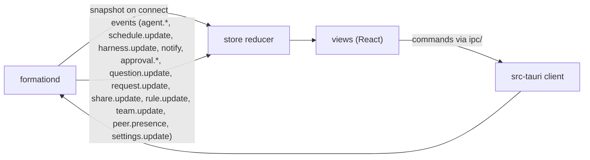

# Formation — Frontend architecture

Rev 1 · 2026-11-09 · Implements the approved [mockup M3](mockups/index.html) and [screens and flows](3_screen_list_and_user_flows.md) (Rev 3) on the stack in the [tech spec](4_techspec.md) (Rev 3). Decision IDs refer to the [planning progress](0_one_pager.md#planning-progress) record.

## Scope

The frontend is the React UI inside the Tauri app. It is an interface to `formationd` (D-048): it holds no agent processes and no durable data of its own, apart from view preferences. Everything it shows comes from a snapshot and an event stream; everything it changes goes out as a command. Contracts are defined in the tech spec: [UI ↔ formationd](4_techspec.md#ui--formationd) and the [data model](4_techspec.md#data-model).

## Windows

| Window | Screens | Notes |
| --- | --- | --- |
| Main window | SC-001 (first-run state), SC-003 to SC-017, SC-020 | One window only in the first version (D-049). Default 1180 × 740 pt, minimum 900 × 560 pt; size, position, selected item, and panel state are restored on reopen. |
| Menu bar panel | SC-002 | A small borderless window anchored to the tray icon (Tauri tray plus the positioner plugin; verify at setup). Separate React entry sharing the same store code. |
| Settings window | SC-018 | Opened with ⌘, or the gear; separate React entry. |
| macOS notifications | SC-019 | Sent by the app with the notification plugin when formationd emits `notify`; a click focuses the related item. |

## Code layout

Inside `apps/desktop/` (from the `create-tauri-app` React + TypeScript scaffold):

```text
apps/desktop/
├── src-tauri/                 Rust: thin client to formationd, LaunchAgent registration, tray, menus, windows, notifications
└── src/
    ├── main.tsx · menubar.tsx · settings.tsx   window entries
    ├── ipc/                   typed command calls and event subscription (generated types)
    ├── store/                 snapshot + event reducer, per-domain slices
    ├── views/                 one folder per screen (see mapping)
    ├── components/            shared components (chat list item, bubble, cards, composer, avatar…)
    ├── ui/                    Radix wrappers: Sheet, Alert, Menu, Popover, Switch, Tabs, Segmented, RadioCards
    ├── styles/                tokens.css (design tokens), base.css
    ├── i18n/                  ko.json, en.json, setup
    └── preview/               component preview page (D-050)
```

**Ownership** (role split confirmed in the implementation plan): developer C owns `ipc/`, `store/`, `views/` logic, and `src-tauri/`; the designer owns `styles/`, component stylesheets (`*.css` beside each component), `i18n/` copy, and `preview/` content. Shared `.tsx` component files are changed by either, through a pull request reviewed by the other.

## Data flow



- **Types:** request, event, and error types are written once in Rust (`formation-proto`) and generated into TypeScript with `ts-rs` (proposed in TASK-002: `cargo test` writes the bindings; C decides where the app build reads them), so the UI and core cannot drift apart.
- **Store:** a single reducer over normalized slices (`agents`, `conversations` keyed by agent, `questions`, `requests`, `approvals`, `team`, `inbox`, `ui`). A small library such as Zustand holds it; selectors feed views.
- **Snapshot then events:** on connect or reconnect the store replaces its contents with formationd's snapshot, then applies events in sequence order. A gap in sequence numbers triggers a new snapshot.
- **Immediate feedback:** every action shows a pending state within 100 ms (doc 3 direction), then settles on the confirming event or shows the mapped error.
- **Streaming:** `agent.stream` events append partial text and steps to the open conversation; lists show only the latest line.

## Screen mapping

| SC | View or component | Main data | Commands | States to implement (from M3) |
| --- | --- | --- | --- | --- |
| SC-001 | `views/welcome` | harness check, team | `team_create`, `team_join`, `settings_notifications` | default, harness-missing, invite-expired |
| SC-002 | `menubar.tsx` | agents, inbox counts | `focus_item` | default, all-clear, offline |
| SC-003 | `components/sidebar` (TopIcons, NeedsYou, ChatList, ChatItem, ProfileBar) | agents, conversations, people, inbox count | `navigate` (UI only) | default, empty, detecting |
| SC-004 | `views/new-agent` (PlusMenu, NewAgentSheet, AvatarPicker, HarnessPicker) | harness status | `agent_create` | plus-menu, default, harness-not-ready, name-taken |
| SC-005 | `views/my-conversation` (PillHeader, MessageList, StepGroup, RequestCard, PermissionCard, QueuedChip, Composer) | conversation, queue, approvals | `agent_message_send`, `agent_message_steer`, `agent_message_withdraw`, `agent_stop`, `agent_start`, `approval_decide` | working, idle, queued, permission, approval, stalled, error, stopped, detected, stop-confirm |
| SC-006 | `views/instructions` (InstructionsSheet) | agent files | `agent_files_read`, `agent_files_write` | default, unsaved, changed-on-disk |
| SC-007 | `views/schedules` (panel section, ScheduleSheet) | schedules, runs | `schedule_*` | panel, sheet, missed, failed, empty |
| SC-008 | `views/sharing` (panel section, PreviewSheet, UnshareAlert) | agent_share | `share_update`, `share_preview` | shared, private, preview, unshare-confirm |
| SC-009 | `views/connect` (ConnectAgentsSheet) | detected agents, capabilities | `agent_connect` | connectable, read-only, not-supported |
| SC-010 | `views/inbox` | inbox items | `approval_open`, `question_answer`, `question_handoff` | default, empty |
| SC-011 | `views/approval` (ApprovalSheet, RulePreview, DenyAlert) | approval, proposed rule | `approval_decide` | default, keep-similar, expiring, expired, deny-confirm |
| SC-012 | `views/rules` | rules | `rules_update`, `rules_revoke` | default, empty |
| SC-013 | `views/team` | members, invitation | `team_invite`, `team_remove` | default, only-me, invite |
| SC-014 | `views/member` | member, shared agents | `ask`, `request_create` | online, offline, no-shared |
| SC-015 | `views/ask-conversation` (PillHeader, AnswerBubble, ChoiceCard, WaitingCard, Composer) | question thread | `ask`, `question_cancel`, `question_refresh`, `question_route_choose` | answered, new, received, answering, unsure, stale, offline-waiting, sent-to-owner, unshared, error |
| SC-016 | `views/work-request` (ComposeSheet, StatusSheet) | request | `request_create`, `request_cancel` | compose, status, not-accepted |
| SC-017 | `views/history` | activity, questions | `history_delete` | default, delete-confirm, empty-filter |
| SC-018 | `settings.tsx` | settings, harness status | `settings_*`, `team_leave` | general, harnesses, notifications, team |
| SC-019 | `src-tauri` notification bridge | `notify` events | — | approval, error |
| SC-020 | `components/info-panel` | agent details | opens SC-006, SC-007, SC-008 | my-agent, teammate-agent, person, collapsed |

## Design system in code

- **Tokens:** `styles/tokens.css` defines the doc 3 tokens as CSS variables (backgrounds, sidebar, selection, bubbles, primary, text levels, separators, state colors, radii, spacing), with dark values under `prefers-color-scheme: dark`. Components use only variables, never raw colors. The mockup's CSS is the starting point.
- **Primitives:** Radix provides behavior and accessibility for Dialog (sheets, alerts), DropdownMenu (+ menu), Popover, Switch, Tabs, ToggleGroup (segmented), RadioGroup (harness and avatar pickers), and Tooltip. `ui/` wraps each with Formation's styles.
- **Avatars:** `components/AgentAvatar` uses `open-bot-avatar`: `renderAvatarSvg` for list stills (cheap at 40 pt) and `mountAvatar` for the pill and panel, with the thinking motion while the agent works and none under Reduce Motion. Badges (state dot, owner initial) are Formation's own overlay (D-042).
- **Typography:** system fonts (SF Pro, Apple SD Gothic Neo) and SF Mono, sizes from doc 3.
- **Native feel:** window vibrancy for the sidebar where supported, native traffic lights, macOS-style focus rings in the system accent color.

## Preview page (D-050)

A development-only page at `preview/` lists every shared component and every screen state from the mapping table, with the mockup's sample data, a theme switch, and a language switch, like the mockup's review bar. The designer's agent changes styles and checks them here before a pull request. It is excluded from release builds.

## Behavior details

- **Navigation:** the sidebar sets `ui.view` (`conversation` with a target, or `inbox`, `team`, `member`, `history`, `rules`). Top icons and chat items switch views; ⌘K opens a quick switcher over the chat list.
- **Menus and shortcuts:** the app menu is built in `src-tauri` with accelerators (⌘N new question, ⇧⌘N new agent, ⌘K go to conversation, ⌘↩ send, ⌘. stop, ⌘S save, ⌘, settings) and emits events the UI handles. Esc closes sheets; the approval sheet asks before denying and binds no Return action.
- **Access denial and errors:** error codes from formationd map to view states, for example `agent_not_shared` → unshared, `peer_offline` → waiting, `rate_limited` → error banner. Banners always offer one recovery action.
- **Reconnect:** if formationd is unreachable, a banner explains it and retries; the CLI command to start it is shown.
- **Localization:** `i18next` with `ko.json` and `en.json`; keys grouped by view; the language follows macOS unless set in Settings (D-033). No user-facing text is hard-coded.

## Reuse from open-source competitors (D-051)

Before building a component from scratch, inspect these permissively licensed projects and copy what fits, keeping their license notices and recording each source in `THIRD_PARTY_NOTICES.md` (path, upstream repository, commit, license):

| Source | License (checked 2026-11-09) | Look at for |
| --- | --- | --- |
| [Happier](https://github.com/happier-dev/happier) | MIT, TypeScript | Rendering Claude Code and Codex sessions: messages, tool steps, permission prompts, session sharing screens |
| [Happy](https://github.com/slopus/happy) | MIT, Swift and TypeScript | Session list and conversation UI patterns for Claude Code and Codex |
| [Paperclip](https://github.com/paperclipai/paperclip) | MIT, TypeScript | Approval and governance screens |

AGPL-3.0 projects (HAPI, Claude Squad) and Flowpad (no license) are for reading only; their code is not copied into Formation, which is MIT-licensed.

## Accessibility (NFR-009)

- Every control has a localized accessible name; Radix handles focus trapping and restoration in sheets and menus.
- Full keyboard use: Tab order follows the visual order; arrow keys move in the chat list and segmented controls.
- State always pairs color with an icon and a text label.
- Reduce Motion stops avatar motion and transitions.
- Manual VoiceOver pass on SC-003, SC-005, SC-011, and SC-015 before release to the team.

## Testing

| What | How |
| --- | --- |
| Store reducer: snapshot, event ordering, gap handling | Vitest unit tests |
| Components: chat item, composer queue states, approval sheet keyboard rules, answer bubble staleness | Vitest with React Testing Library |
| IPC types match formationd | Type generation in the build; a compile error on mismatch |
| Visual states | Preview page review by the designer for each pull request |
| Core journeys in the real app | Manual checks listed in the implementation plan |

## Assumptions to verify

- The create-tauri-app React template uses Vite (tech spec).
- A tray-anchored panel window can be positioned under the tray icon with the positioner plugin on macOS 13.
- `open-bot-avatar`'s live renderer performs well with a dozen avatars on screen; otherwise use stills everywhere except the pill.
