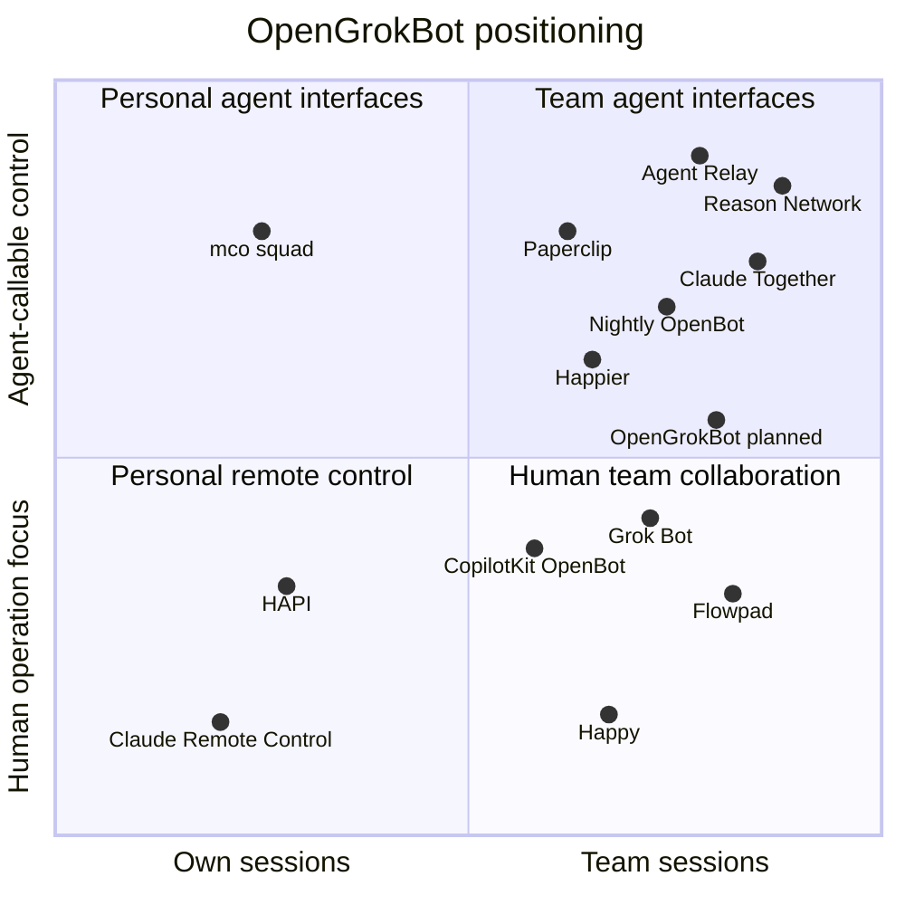

# Competitive landscape

Research date: October 9, 2026. Updated November 9, 2026 with Reason Network, Paperclip, Grok Bot, mco-org squad, and adjacent multi-agent tools, and November 19, 2026 with the two products named OpenBot (nightly-labs and CopilotKit).

This comparison uses official product pages, documentation, and public repositories. It is not an installation-based performance or security evaluation. Documentation may describe experimental features or development branches rather than a stable release. An unverified capability is not an absent capability.

## Feature matrix

**O** documented · **X** outside the supported product scope · **?** not verified · **Planned** OpenGrokBot's intended capability, not implemented.

| Product | Claude and Codex | Teammate participation or messaging | Agent-callable CLI or MCP control | Per-collaborator execution approval delegation | Side questions isolated from the main session |
|---|:---:|:---:|:---:|:---:|:---:|
| OpenGrokBot | Planned | Planned | Planned | Planned | Planned |
| [Happier](https://github.com/happier-dev/happier) | O | O | O | [O](https://docs.happier.dev/accounts/session-sharing) | ? |
| [Reason Network](https://github.com/reason-machines/reason-network) | O | O | O | ? | ? |
| [Flowpad](https://flowpad.ai/) | O | O | ? | ? | ? |
| [Agent Relay](https://github.com/AgentWorkforce/relay) | O | O | O | ? | ? |
| [Paperclip](https://github.com/paperclipai/paperclip) | O | O | ? | ? | ? |
| [OpenBot (nightly-labs)](https://github.com/nightly-labs/openbot) | O | O | O | ? | ? |
| [OpenBot (CopilotKit)](https://github.com/CopilotKit/OpenBot) | ? | O | ? | ? | ? |
| [Grok Bot](https://x.ai/news/grok-bot-more-plans) | ? | O | ? | ? | ? |
| [Claude Together](https://github.com/wybe-labs/claude-together) | ? | O | O | ? | ? |
| [squad (mco-org)](https://github.com/mco-org/squad) | O | ? | O | ? | ? |
| [Happy](https://github.com/slopus/happy) | O | O | ? | ? | ? |
| [HAPI](https://github.com/tiann/hapi) | O | ? | ? | ? | ? |
| [Claude Remote Control](https://code.claude.com/docs/en/remote-control) | X | ? | ? | ? | ? |

Agent-callable control means an interface for querying or sending messages to sessions, not merely a CLI that installs or launches the product. Approval delegation means granting a particular collaborator approval authority, not simply approving one's own agent from another device.

The matrix distinguishes conversation isolation from filesystem isolation. Generic session forks or subagents do not establish that a product offers OpenGrokBot's proposed restricted side-question workflow.

## Positioning map

The following is a qualitative map of documented workflows, not a quantitative ranking. Coordinates only arrange labels within categories; they are not measured scores. Products may span more than one category. OpenGrokBot's position is a target.

| Positioning category | Products |
|---|---|
| Team workflows with agent-callable interfaces | Agent Relay, Claude Together, Happier, OpenBot (nightly-labs), Paperclip, Reason Network; OpenGrokBot's target. |
| Personal agent-to-agent coordination | mco-org squad. |
| Human team collaboration | Flowpad, current Happy Harness, Grok Bot Shared Bots, and OpenBot (CopilotKit). |
| Personal remote control emphasis | HAPI and Claude Remote Control. |

Paperclip's team workflow is an organization hierarchy: agents receive delegated work through goals and tasks. It does not center on owners sharing their existing local sessions with each other. The nightly-labs OpenBot's team workflow is a server, published from a member's computer or run on a hosted or self-hosted machine; members join it and work with the agents that OpenBot started there. CopilotKit's OpenBot is a self-hosted team workspace whose Bots run on its server or connect as remote agents; its README describes no local coding sessions. mco-org squad coordinates agents in one local workspace; team use across machines was not verified. Grok Bot shares one cloud agent with a team through private per-person chats rather than sharing local coding sessions. Happier also provides human collaboration. Happy supports subagent delegation, but an external agent-callable team-session interface was not verified. HAPI supports multiple clients on certain shared executions; that alone does not establish collaborator-specific team permissions.

## Product findings and official links

### Happier

- Landing page: [happier.dev](https://happier.dev/).
- Sources: [repository](https://github.com/happier-dev/happier), [session sharing](https://docs.happier.dev/accounts/session-sharing), [CLI](https://docs.happier.dev/apps/cli).

Supports multiple providers, session sharing, CLI and MCP control, and approval delegation. Direct sharing has view, edit, and manage levels; approval authority is a separate per-person setting. Friends, required for direct sharing, is experimental and disabled by default according to the sharing documentation.

This is one of the two closest broad comparisons, with Reason Network. Sharing, permissions, and a CLI are not sufficient differentiation on their own.

### Reason Network

- Landing page: [reasonmachines.com/network](https://reasonmachines.com/network).
- Sources: [repository](https://github.com/reason-machines/reason-network), [design document](https://github.com/reason-machines/reason-network/blob/main/DESIGN.md).

Connects a team's coding-agent sessions across machines so that agents can message each other. A daemon runs on each computer; on macOS a menu bar icon shows who is online and what they are doing. Agents use an MCP server (`list_team`, `send_message`, `message_status`, `ask_user`, `check_inbox`) and a `reason-network` CLI. Messages can target one session (`alice/api-claude`), a person's sessions, a repository, or everyone, and wait for offline recipients. Dual-licensed MIT OR Apache-2.0; sign-in is free.

Harness coverage is broad: Claude Code, Codex, Hermes, opencode, pi, Cursor, Gemini CLI, Copilot CLI, Grok CLI, Command Code, DeepSeek Harness, and Reason, among others. Delivery timing differs by harness: push into a running or idle session (Claude Code, Codex, opencode, pi, Reason), at the next tool call or turn end (Cursor, Gemini CLI, Copilot CLI, Grok CLI, Command Code), or only when the agent checks its inbox. `reason-network setup` detects installed agents and wires their hooks and MCP configuration. Claude Code sessions are discovered from local session files, so they appear with busy or idle state even without the MCP server. Teammates see each session's repository, branch, and status; folders can be excluded from the network.

Connections are end-to-end encrypted and peer to peer through iroh, with a relay fallback that teams can self-host. Permission controls documented in the design are an inbound policy per machine (`accept`, `hold`, or `refuse`, overridable per person), membership limits, guards against agent-to-agent loops and group broadcasts, and an `ask_user` pop-up through which the owner approves or denies a request. Command-level grants and delegating approval authority to a collaborator were not found in the reviewed documentation.

The design describes peer messages entering the recipient's existing session, labeled as peer input; a separate side conversation isolated from the main session was not described. This overlaps directly with OpenGrokBot's core direction (asking a teammate's agent), with multi-harness detection, and with discovering the agents running on one machine. Treat it as a primary hands-on comparison and as a possible extension or integration base; its permissive license allows reuse.

### Flowpad

- Landing page: [flowpad.ai](https://flowpad.ai/).
- Source: [repository and CLI documentation](https://github.com/langware-labs/flowpad).

The product page explicitly offers inviting teammates or external advisors into Claude Code and Codex CLI sessions, with shared work context. The repository documents macOS distribution and server-management commands. Detailed execution policies and isolated side questions were not verified.

The repository calls the project open source while its license section displays an all-rights-reserved notice. Do not assume reusable licensing without further review.

### Agent Relay

- Landing page: [agentrelay.com](https://agentrelay.com/).
- Sources: [repository](https://github.com/AgentWorkforce/relay), [introduction](https://agentrelay.com/docs/introduction).

Provides agent messaging across machines and team-session context search. It overlaps with OpenGrokBot's agent-to-agent query direction and may also be an integration candidate. This comparison refers specifically to AgentWorkforce/relay, not other similarly named projects.

### Paperclip

- Landing page: [paperclip.ing](https://paperclip.ing/).
- Sources: [repository](https://github.com/paperclipai/paperclip), [documentation](https://docs.paperclip.ing/), [approvals guide](https://docs.paperclip.ing/guides/day-to-day/approvals/) (hire and strategy approvals; the tool-gateway rules below come from the repository README), [adding a human teammate](https://docs.paperclip.ing/how-to/add-a-human-teammate/), [Agent Chat](https://docs.paperclip.ing/experimental/agent-chat/), [deployment modes](https://docs.paperclip.ing/reference/deploy/deployment-modes/).

A self-hosted, MIT-licensed Node.js server and React UI that runs teams of agents as an organization. Agents on Claude Code, Codex, Cursor, Gemini CLI, OpenClaw, and other runtimes join a mixed human-and-agent org chart with roles, reporting lines, permissions, and budgets. Work flows through goals, tasks, and threaded conversations. Heartbeats wake agents for assigned work, follow-up messages, or schedules.

The repository documents human roles and permissions, company memberships, invite flows, and agent API keys. Governance includes board approval workflows, review stages, budget hard-stops, and pausing or terminating agents. Calls through its tool gateway can be approved once or saved as a revocable rule. Agents delegate to each other through tasks and comments using agent API keys. An interface for querying or messaging another person's session was not verified, so the matrix marks agent-callable control as unverified. The repository was created in March 2026 and had over 100,000 GitHub stars as of November 9, 2026.

Multiple human users require the authenticated deployment mode; the quickstart defaults to a trusted local loopback mode. Members with invite permission, by default Owners and Admins, create invites from Settings → Members → Invites. Each invite carries a Viewer, Operator (default), Admin, or Owner role. Invite links are copied and shared manually, work once, expire after 72 hours, and take effect without a separate approval step.

Experimental Agent Chat is off by default and is enabled for the whole instance. It gives each person one ongoing conversation with each agent in the company. Teammates can read a conversation, but only its owner can post in it. The agent can research and draft a plan in chat and hands substantial work off to ordinary tasks; the documentation describes each conversation as a task behind the scenes. Which tools chat can use, and whether chat shares session state with the agent's task work, were not documented.

The landing page and the README invite visitors to join a Paperclip Cloud waitlist, and the README roadmap lists cloud deployments as in progress. The documentation says Cloud Sync to a Paperclip Cloud upstream was removed in v2026.1012.0. A generally available hosted version was not verified.

This is the strongest documented overlap on organization-level governance and approvals. Its approval choices resemble OpenGrokBot's "allow once" and "keep allowing similar commands." Its center is delegating work down an organization hierarchy, not asking a teammate's existing local session a question without disturbing it. Not verified: whether its approvals cover coding agents' local shell and file tool calls, and whether Agent Chat is isolated from the agent's task sessions.

### OpenBot (nightly-labs)

- Landing page: [openbot.run](https://openbot.run/).
- Sources: [repository and README](https://github.com/nightly-labs/openbot), [Team API](https://github.com/nightly-labs/openbot/blob/main/docs/architecture/team-api.md), [agents](https://github.com/nightly-labs/openbot/blob/main/docs/architecture/agents.md), [providers](https://github.com/nightly-labs/openbot/blob/main/docs/architecture/providers.md), [pricing](https://openbot.run/pricing), [comparison pages](https://openbot.run/compare), [X account](https://x.com/OpenBot_). Reviewed on November 19, 2026.

Not related to CopilotKit's OpenBot, which is reviewed next. A desktop app built on Electron and SolidJS, for macOS 13 or later, Windows, and Linux, with iPhone and Android apps that connect to it, from Synthetify Labs in Poland. It runs persistent agents on the user's computer, each with its own name, instructions, workspace, and conversation. OpenBot starts each provider's CLI or SDK as a local process and keeps one conversation per agent when the agent switches provider. Codex runs through the Codex App Server, Claude through the Claude Agent SDK, Pi through its RPC mode, Muse through its own SDK, and Grok, OpenCode, Gemini (Google's Antigravity CLI), Cursor, Cline, Kimi, Devin, GitHub Copilot, Mistral Vibe, Hermes, and user-added agents through the Agent Client Protocol (ACP). Inception, DeepSeek, and OpenRouter models run on Pi. Custom OpenAI-compatible endpoints and detected local model servers such as Ollama and LM Studio are also supported; the provider notes indicate that Pi runs a custom endpoint's models. OpenBot uses each CLI's existing login and downloads and pins most of the CLIs. Connecting Claude Code or Codex sessions started outside OpenBot was not documented.

The README warns that agents run with `danger-full-access` and `approvalPolicy: never`, without per-action confirmation after a first-launch consent. The architecture notes also describe a Workspace only access setting and an Ask first mode that only the user can change to Full access, and the agent import treats Workspace only and Ask first as a new agent's permissions. The two descriptions disagree, and which mode a new agent starts with was not tested. Agents message each other through a `send_message` tool, and channels put people and agents in one chat with a task owner and explicit delegation. A message that arrives while an agent works steers the running turn by default; it waits in the queue instead when the agent's busy-message mode is set to queue or the provider cannot steer. Messages from other agents follow the same mode. Side threads give one agent further conversations, each with its own provider thread and queue, and the agent can search its other conversations with history tools. Routines, webhooks, and workflows with approval steps run scheduled and multi-step work.

For a team, the host publishes its OpenBot as a server. Members connect from the desktop, web, or mobile apps over WebRTC, with signaling and a TURN relay that teams can self-host; the account service on Cloudflare holds accounts, memberships, and invitations but carries no chats, files, or commands. A member can belong to several servers, and managed hosted servers or a self-hosted Linux server let agents run without a personal computer. Roles are owner, admin, and member, and each agent has view, chat, and manage access levels. Cursor and Cline agents stay on the host and are not shown to team members. Members with chat access read and write in the agent's chats, which appear to be shared among members rather than private to each person. A member with chat access on an agent can also read its pending approvals, and the clients offer Allow on them. Owner-only cards, such as the one for deleting agents, are described as ones a member cannot answer, so ordinary approvals appear to follow chat access rather than a separate grant; the reviewed documents do not state who may answer them. The company announced Multiplayer Mode on X on November 13, 2026.

The repository was created on August 12, 2026, and had 8,891 GitHub stars and about 860 forks on November 19, 2026. v0.73.0, released on November 18, 2026, was the 114th desktop release since v0.1.0 on August 13. Versions up to 0.1.11 were Apache-2.0; later versions use the source-available PolyForm Noncommercial License 1.0.0. Personal use is free, and commercial use needs a paid license: Starter at €10 a month for one member, or Team at €25 a month for two members, with a further charge for each added member (the README says 2 to 10 users). The pricing page shows both licenses as free until December 1, 2026. Managed servers cost €30 to €100 a month. Forks grew fastest in the last week of October 2026. Earlier that month, posts on X from the company (October 6) and from its top contributor (October 19) presented OpenBot as a free, open-source alternative to Grok Bot; the site's comparison page calls it a free, local alternative. The site also compares OpenBot with Paperclip and other agent apps, and OpenBot imports agents exported from Grok Bot.

This is among the closest documented overlaps with OpenGrokBot's plan: local Claude Code and Codex agents, teammates working with one person's agents from other machines, per-agent access levels, approvals that other members can read, schedules, and mobile access. It differs in how a teammate reaches the agent. OpenBot runs sessions it started, while OpenGrokBot connects existing sessions and answers from them. A teammate's message in OpenBot enters the agent's chat, which other members read, and steers the running turn or waits in its queue; OpenGrokBot proposes a separate side conversation with no tools that leaves the main session untouched. OpenBot's README describes agents running with full access and no per-action confirmation, while OpenGrokBot gates teammates' work requests with command-level rules on the owner's Mac. The licenses also differ: noncommercial with paid commercial licenses, against MIT. Not verified hands-on: whether a teammate can ask in a side thread that reads the main chat without disturbing it, who can answer a pending tool approval when several members have chat access, and which access and approval mode a new agent starts with.

### OpenBot (CopilotKit)

- Landing page: [open.bot](https://open.bot).
- Source: [repository and README](https://github.com/CopilotKit/OpenBot). Reviewed on November 19, 2026; only the README and the repository's metadata were read.

Not related to the nightly-labs OpenBot above, despite the name. A self-hostable workspace for AI coworkers from CopilotKit, the company behind the AG-UI protocol, aimed at enterprises. A desktop app for macOS and Windows bundles the frontend with a Docker-based backend for one person; teams deploy the backend on Kubernetes with Helm charts. The README also lists web, iOS, Android, Slack, and Microsoft Teams frontends, each behind an early-access sign-up. Built-in Bots run in the OpenBot server, and any AG-UI endpoint can be registered as a Bot, so agents built on frameworks such as the Claude Agent SDK, LangGraph, or Mastra, or hosted on other platforms, join the same workspace, through an adapter where needed. Models are OpenAI, Claude, Gemini, or any OpenAI-compatible endpoint. The README describes a container for each person, with a browser and a shell for that person's Bots; its Kubernetes evaluation setup instead shares one container among all Bots.

A Bot's browser, file, and shell tool calls pass a gateway that evaluates policy rules, records an audit row, and only then acts. Rules are written in CEL, fail closed, and can read the tool, the Bot, the acting person, the command, and what started the run, so a rule can refuse a shell or particular commands. The README also lists approvals, company sign-in (Google, Microsoft, Okta, SAML, or OpenID Connect), roles, per-Bot sharing with private or public visibility, routines, and a REST and WebSocket API in which an API key acts as the person who made it.

The repository was created on August 17, 2026, released v1.1.0 on November 17, 2026, and had 12,841 GitHub stars and 1,594 forks on November 19, 2026. The application template is MIT-licensed. It depends on CopilotKit Intelligence, which is licensed separately: free for local personal use, a free trial for Kubernetes evaluation, and a production license beyond that.

It overlaps with OpenGrokBot on shared agents with roles, approvals, and command rules that can name the acting person. It differs in where agents run and what they are: the README describes server-side Bots and remote AG-UI agents working in containers, and no Claude Code or Codex sessions running on a teammate's Mac. Not verified: connecting local Claude Code or Codex sessions, whether the API lets one person's agent ask another person's Bot, who answers a shared Bot's approvals, and whether conversations with a shared Bot are private to each person.

### Grok Bot

- Announcement: [x.ai news](https://x.ai/news/grok-bot-more-plans).
- Sources: [Shared Bots documentation](https://docs.x.ai/grok-bot/shared-bots), [deep dive by Flavio Copes](https://flaviocopes.com/grok-bot/) (secondary).

An AI-teammate service from SpaceX Super Intelligence; a secondary source describes it as xAI's product. The announcement page's footer reads "Built with Grok", and its macOS download is hosted by Cursor. The beta launched on August 11, 2026. Users can message a Bot from mobile or desktop. Access comes with SuperGrok and Cursor plans, with Bot usage metered separately, and enterprise customers can join a waitlist. Users message Bots like coworkers. A cloud Bot has an always-on computer with browser and terminal access, works across connected apps, and can run routines while the user is away. Several Bots can share a group chat and hand work to each other.

A Shared Bot is shared with a whole team or with chosen people and groups, without making a copy. The owner and Managers can change its instructions, skills, memory, and apps; Collaborators can only chat. Each person's chat is private from the owner and Managers. The Bot can save what it learns for the whole team and says when it does. In a teammate's chat it uses the owner's apps and secrets, asks before using the teammate's own accounts, and usually runs on the teammate's Grok Bot computer. Approval cards, such as the one for using the teammate's own accounts or for reviewing an action in a Slack thread, go to the person the Bot is answering. Because approval follows the asker rather than authority the owner grants to a collaborator, the matrix leaves approval delegation unverified. Only cloud Bots can be shared; a Bot that runs on the user's own computer cannot.

This is the closest documented match to OpenGrokBot's experience of teammates asking one person's agent in their own private conversations. It differs in where a shared agent runs (the vendor's cloud, not the owner's machine), in scope (general business work rather than Claude Code and Codex coding sessions), in model (the announcement reads "Built with Grok"), and in licensing (a closed, paid service). Its approval model also differs: approval cards go to the person asking, while OpenGrokBot proposes that the owner's local service makes the final decision. Support for Claude Code or Codex sessions was not documented. Not verified: whether team memory written from one chat changes the Bot's behavior in other people's chats.

### squad (mco-org)

- Sources: [repository](https://github.com/mco-org/squad), [documentation](https://mco-org.github.io/squad/).

A Rust CLI under the MIT license. Claude Code, Codex CLI, Gemini CLI, and OpenCode terminals use it to message each other through shell commands and a SQLite workspace, with no daemon. A `/squad` slash command (`$squad` in Codex) assigns roles such as manager, worker, and inspector, and the manager splits a goal into tasks for workers.

It overlaps with OpenGrokBot's agent-to-agent direction but documents a local workspace in one project. Cross-machine or cross-person use, permissions, and approvals were not verified. It is unrelated to the other Squad-named projects listed below.

### Claude Together

- Official project page: [GitHub](https://github.com/wybe-labs/claude-together). No separate landing page was identified.

Connects Claude sessions on different machines and accounts through MCP, hooks, and encrypted peer connections. Project registration is opt-in; receivers control whether a room can interrupt a running session. General Codex support and per-command collaborator execution grants were not verified.

### Happy

- Landing page: [happy.engineering](https://happy.engineering/).
- Source: [repository](https://github.com/slopus/happy).

The original CLI emphasizes continuing Claude Code or Codex sessions from other devices. The current Happy Harness also documents inviting colleagues into a session and allowing either participant to steer it. Treat it as a team-collaboration competitor, not only a personal remote-control tool.

### HAPI

- Landing page: [hapi.run](https://hapi.run/).
- Sources: [repository](https://github.com/tiann/hapi), [Codex shared executions](https://hapi.run/docs/guide/codex-shared-sessions).

Provides remote control and approvals for local coding agents. Supported Codex versions can share an app-server between native terminal and remote clients. Its documented process ownership and lifecycle are useful implementation references. Fine-grained collaborator grants and isolated side questions were not verified.

### Claude Remote Control

- Product landing page: [Claude Code](https://claude.com/product/claude-code).
- Feature documentation: [Remote Control](https://code.claude.com/docs/en/remote-control).

An official way to continue one's local Claude session from web or mobile while execution stays on the local machine. It is a Claude-specific feature, not a dual-provider product. Cross-person session permissions and an agent query interface were not verified in the reviewed documentation.

## Adjacent multi-agent tools

These tools orchestrate several agents but do not share sessions between people. They are listed for context, and because several share the "Squad" name.

- [Agent Squad](https://github.com/2FastLabs/agent-squad): an Apache-2.0 framework in Python, TypeScript, and Swift. It routes each user query to the most suitable specialized agent and keeps conversation context across agents. It was previously `awslabs/agent-squad` and, before that, `multi-agent-orchestrator`; 2 Fast Labs now maintains it. It is a library for building multi-agent applications. Its Swift runtime runs on device on macOS 14 and iOS 16 or later.
- [Squad](https://github.com/github/squad) (GitHub): human-led AI agent teams for a repository through GitHub Copilot. Specialist members persist as files in the repository. It installs as `@bradygaster/squad-cli`. It is built primarily around GitHub Copilot, and its `--client` option projects the same team into Claude Code, Codex, OpenCode, Cursor, and other hosts. It serves one operator's repository rather than sharing live sessions between people.
- [Claude Squad](https://github.com/smtg-ai/claude-squad): an AGPL-3.0 terminal app for running several terminal agents, such as Claude Code, Codex, Gemini, Aider, OpenCode, and Amp, in parallel. Team sharing was not verified.

Naming note: at least four agent tools use the Squad name, counting mco-org squad above. squads-cli and SquadCue also appeared in search results but were not reviewed. On November 9, 2026, the product's working title changed from Shared to Formation. A quick search that day found no agent orchestration tool named "Formation". That search was not a trademark, domain, or package-name check. On the same day the team renamed the product to OpenGrokBot ([D-057](0_one_pager.md#planning-progress), [issue #11](https://github.com/callmejustdodo/OpenGrokBot/issues/11)). The risks recorded in that issue still apply: Grok is xAI's brand and Grok Bot is an AI product in the same field, Oracle maintains an open-source project named OpenGrok, and `GrokBot` is the user agent of xAI's web crawler. No trademark review had been recorded when the rename was adopted. Two unrelated products are named OpenBot, both reviewed above: the nightly-labs repository was created on August 12, 2026, and CopilotKit's on August 17, 2026. Both are promoted as free, open-source alternatives to Grok Bot, which is the idea the OpenGrokBot name signals, so the name now sits close to two established products.

## OpenGrokBot's differentiation hypotheses

OpenGrokBot's strongest proposed experience is: **ask a teammate's agent without disrupting their main task, and turn an answer into work only within the owner's policy.**

Validate these together:

- Side questions with explicitly restricted context and no writes to the source workspace.
- Visible context revisions so old answers are not mistaken for current project state.
- Deterministic, collaborator-scoped command rules.
- The same policy and request lifecycle across the macOS app and agent CLI.
- A small, understandable installation and approval experience.

These are hypotheses, not claims that competitors lack these features. In particular, the side-question column still needs hands-on investigation. Paperclip documents approve-once and revocable-rule approvals, so approval choices alone are not differentiation. Grok Bot's Shared Bots and Paperclip's Agent Chat both document per-person conversations with a shared agent, so a separate conversation alone is not differentiation either. Their privacy differs: Grok Bot chats are private from the owner, while teammates can read Paperclip Agent Chat conversations.

The nightly-labs OpenBot documents per-agent chat access for teammates, side threads, and pending approvals that members with chat access can read, so none of these alone is differentiation either. CopilotKit's OpenBot documents policy rules, written as CEL expressions, that can read the acting person and the command, so collaborator-scoped command rules alone are not differentiation; applying them to requests that run in an owner's local Claude Code or Codex session may be. Answering from an existing session in a conversation that cannot change it remains a candidate difference.

## Next comparison experiment

Run the same two-person workflow in Happier, Reason Network, Flowpad, Agent Relay, Paperclip, and the nightly-labs OpenBot: share a session, ask about an implementation decision, query from another agent, submit a test request, approve it, and revoke access.

For Paperclip, also check whether its approvals reach coding agents' local tool calls. Check too whether a teammate can ask a question without creating a task in the organization. Where a plan allows it, also try Grok Bot's Shared Bots to compare private-chat isolation and who approves actions.

For the nightly-labs OpenBot, publish one member's server and have another member ask an agent while it works. Check whether the question steers the running turn or waits behind it, whether it can go to a side thread that reads the main chat, who can answer the agent's approvals, which access and approval mode a new agent starts with, and whether the Workspace only and Ask first settings stop a teammate's request from running commands without approval. CopilotKit's OpenBot documents no local Claude Code or Codex sessions, so it stays out of this workflow; read its policy rules as a reference for command rules.

Compare main-session disruption, permission granularity, existing-session compatibility, setup friction, and host resource use. If an existing product sufficiently solves the workflow, evaluate an extension before committing to a separate app.
