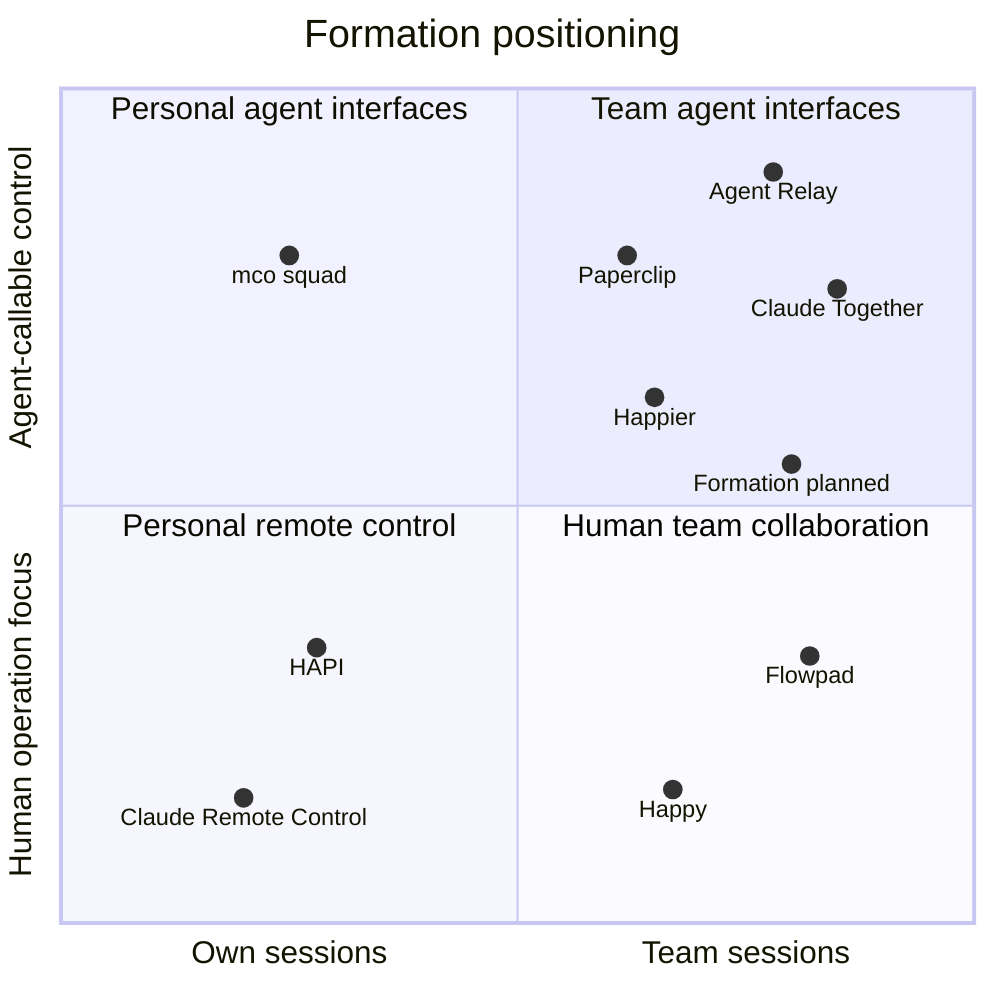

# Competitive landscape

Research date: October 9, 2026. Updated November 9, 2026 with Paperclip, mco-org squad, and adjacent multi-agent tools.

This comparison uses official product pages, documentation, and public repositories. It is not an installation-based performance or security evaluation. Documentation may describe experimental features or development branches rather than a stable release. An unverified capability is not an absent capability.

## Feature matrix

**O** documented · **X** outside the supported product scope · **?** not verified · **Planned** Formation's intended capability, not implemented.

| Product | Claude and Codex | Teammate participation or messaging | Agent-callable CLI or MCP control | Per-collaborator execution approval delegation | Side questions isolated from the main session |
|---|:---:|:---:|:---:|:---:|:---:|
| Formation | Planned | Planned | Planned | Planned | Planned |
| [Happier](https://github.com/happier-dev/happier) | O | O | O | [O](https://docs.happier.dev/accounts/session-sharing) | ? |
| [Flowpad](https://flowpad.ai/) | O | O | ? | ? | ? |
| [Agent Relay](https://github.com/AgentWorkforce/relay) | O | O | O | ? | ? |
| [Paperclip](https://github.com/paperclipai/paperclip) | O | O | ? | ? | ? |
| [Claude Together](https://github.com/wybe-labs/claude-together) | ? | O | O | ? | ? |
| [squad (mco-org)](https://github.com/mco-org/squad) | O | ? | O | ? | ? |
| [Happy](https://github.com/slopus/happy) | O | O | ? | ? | ? |
| [HAPI](https://github.com/tiann/hapi) | O | ? | ? | ? | ? |
| [Claude Remote Control](https://code.claude.com/docs/en/remote-control) | X | ? | ? | ? | ? |

Agent-callable control means an interface for querying or sending messages to sessions, not merely a CLI that installs or launches the product. Approval delegation means granting a particular collaborator approval authority, not simply approving one's own agent from another device.

The matrix distinguishes conversation isolation from filesystem isolation. Generic session forks or subagents do not establish that a product offers Formation's proposed restricted side-question workflow.

## Positioning map

The following is a qualitative map of documented workflows, not a quantitative ranking. Coordinates only arrange labels within categories; they are not measured scores. Products may span more than one category. Formation's position is a target.

| Positioning category | Products |
|---|---|
| Team workflows with agent-callable interfaces | Agent Relay, Claude Together, Happier, Paperclip; Formation's target. |
| Personal agent-to-agent coordination | mco-org squad. |
| Human team collaboration | Flowpad and current Happy Harness. |
| Personal remote control emphasis | HAPI and Claude Remote Control. |

Paperclip's team workflow is an organization hierarchy: agents receive delegated work through goals and tasks. It does not center on owners sharing their existing local sessions with each other. mco-org squad coordinates agents in one local workspace; team use across machines was not verified. Happier also provides human collaboration. Happy supports subagent delegation, but an external agent-callable team-session interface was not verified. HAPI supports multiple clients on certain shared executions; that alone does not establish collaborator-specific team permissions.

## Product findings and official links

### Happier

- Landing page: [happier.dev](https://happier.dev/).
- Sources: [repository](https://github.com/happier-dev/happier), [session sharing](https://docs.happier.dev/accounts/session-sharing), [CLI](https://docs.happier.dev/apps/cli).

Supports multiple providers, session sharing, CLI and MCP control, and approval delegation. Direct sharing has view, edit, and manage levels; approval authority is a separate per-person setting. Friends, required for direct sharing, is experimental and disabled by default according to the sharing documentation.

This is the closest broad comparison. Sharing, permissions, and a CLI are not sufficient differentiation on their own.

### Flowpad

- Landing page: [flowpad.ai](https://flowpad.ai/).
- Source: [repository and CLI documentation](https://github.com/langware-labs/flowpad).

The product page explicitly offers inviting teammates or external advisors into Claude Code and Codex CLI sessions, with shared work context. The repository documents macOS distribution and server-management commands. Detailed execution policies and isolated side questions were not verified.

The repository calls the project open source while its license section displays an all-rights-reserved notice. Do not assume reusable licensing without further review.

### Agent Relay

- Landing page: [agentrelay.com](https://agentrelay.com/).
- Sources: [repository](https://github.com/AgentWorkforce/relay), [introduction](https://agentrelay.com/docs/introduction).

Provides agent messaging across machines and team-session context search. It overlaps with Formation's agent-to-agent query direction and may also be an integration candidate. This comparison refers specifically to AgentWorkforce/relay, not other similarly named projects.

### Paperclip

- Landing page: [paperclip.ing](https://paperclip.ing/).
- Sources: [repository](https://github.com/paperclipai/paperclip), [documentation](https://docs.paperclip.ing/), [approvals guide](https://docs.paperclip.ing/guides/day-to-day/approvals/) (hire and strategy approvals; the tool-gateway rules below come from the repository README).

A self-hosted, MIT-licensed Node.js server and React UI that runs teams of agents as an organization. Agents on Claude Code, Codex, Cursor, Gemini CLI, OpenClaw, and other runtimes join a mixed human-and-agent org chart with roles, reporting lines, permissions, and budgets. Work flows through goals, tasks, and threaded conversations. Heartbeats wake agents for assigned work, follow-up messages, or schedules.

The repository documents human roles and permissions, company memberships, invite flows, and agent API keys. Governance includes board approval workflows, review stages, budget hard-stops, and pausing or terminating agents. Calls through its tool gateway can be approved once or saved as a revocable rule. Agents delegate to each other through tasks and comments using agent API keys. An interface for querying or messaging another person's session was not verified, so the matrix marks agent-callable control as unverified. The repository was created in March 2026 and had over 100,000 GitHub stars as of November 9, 2026.

This is the strongest documented overlap on organization-level governance and approvals. Its approval choices resemble Formation's "allow once" and "keep allowing similar commands." Its center is delegating work down an organization hierarchy, not asking a teammate's existing local session a question without disturbing it. Not verified: whether its approvals cover coding agents' local shell and file tool calls, and whether one person can query another person's live session in an isolated conversation.

### squad (mco-org)

- Sources: [repository](https://github.com/mco-org/squad), [documentation](https://mco-org.github.io/squad/).

A Rust CLI under the MIT license. Claude Code, Codex CLI, Gemini CLI, and OpenCode terminals use it to message each other through shell commands and a SQLite workspace, with no daemon. A `/squad` slash command (`$squad` in Codex) assigns roles such as manager, worker, and inspector, and the manager splits a goal into tasks for workers.

It overlaps with Formation's agent-to-agent direction but documents a local workspace in one project. Cross-machine or cross-person use, permissions, and approvals were not verified. It is unrelated to the other Squad-named projects listed below.

### Claude Together

- Official project page: [GitHub](https://github.com/wybe-labs/claude-together). No separate landing page was identified.

Connects Claude sessions on different machines and accounts through MCP, hooks, and encrypted peer connections. Project registration is opt-in; receivers control whether a room can interrupt a running session. General Codex support and per-command collaborator execution grants were not verified.

### Happy

- Landing page: [happy.engineering](https://happy.engineering/).
- Source: [repository](https://github.com/slopus/happy).

The original CLI emphasizes continuing Claude Code or Codex sessions from other devices. The current Happy Harness also documents inviting colleagues into a session and allowing either participant to steer it. Treat it as a team-collaboration competitor, not only a personal remote-control tool.

### HAPI

- Landing page: [hapi.run](https://hapi.run/).
- Sources: [repository](https://github.com/tiann/hapi), [Codex shared executions](https://hapi.run/docs/guide/codex-shared-sessions).

Provides remote control and approvals for local coding agents. Supported Codex versions can share an app-server between native terminal and remote clients. Its documented process ownership and lifecycle are useful implementation references. Fine-grained collaborator grants and isolated side questions were not verified.

### Claude Remote Control

- Product landing page: [Claude Code](https://claude.com/product/claude-code).
- Feature documentation: [Remote Control](https://code.claude.com/docs/en/remote-control).

An official way to continue one's local Claude session from web or mobile while execution stays on the local machine. It is a Claude-specific feature, not a dual-provider product. Cross-person session permissions and an agent query interface were not verified in the reviewed documentation.

## Adjacent multi-agent tools

These tools orchestrate several agents but do not share sessions between people. They are listed for context, and because several share the "Squad" name.

- [Agent Squad](https://github.com/2FastLabs/agent-squad): an Apache-2.0 framework in Python, TypeScript, and Swift. It routes each user query to the most suitable specialized agent and keeps conversation context across agents. It was previously `awslabs/agent-squad` and, before that, `multi-agent-orchestrator`; 2 Fast Labs now maintains it. It is a library for building multi-agent applications. Its Swift runtime runs on device on macOS 14 and iOS 16 or later.
- [Squad](https://github.com/github/squad) (GitHub): human-led AI agent teams for a repository through GitHub Copilot. Specialist members persist as files in the repository. It installs as `@bradygaster/squad-cli`. It is built primarily around GitHub Copilot, and its `--client` option projects the same team into Claude Code, Codex, OpenCode, Cursor, and other hosts. It serves one operator's repository rather than sharing live sessions between people.
- [Claude Squad](https://github.com/smtg-ai/claude-squad): an AGPL-3.0 terminal app for running several terminal agents, such as Claude Code, Codex, Gemini, Aider, OpenCode, and Amp, in parallel. Team sharing was not verified.

Naming note: at least four agent tools use the Squad name, counting mco-org squad above. squads-cli and SquadCue also appeared in search results but were not reviewed. On November 9, 2026, the product's working title changed from Shared to Formation. A quick search that day found no agent orchestration tool named "Formation". That search was not a trademark, domain, or package-name check.

## Formation's differentiation hypotheses

Formation's strongest proposed experience is: **ask a teammate's agent without disrupting their main task, and turn an answer into work only within the owner's policy.**

Validate these together:

- Side questions with explicitly restricted context and no writes to the source workspace.
- Visible context revisions so old answers are not mistaken for current project state.
- Deterministic, collaborator-scoped command rules.
- The same policy and request lifecycle across the macOS app and agent CLI.
- A small, understandable installation and approval experience.

These are hypotheses, not claims that competitors lack these features. In particular, the side-question column still needs hands-on investigation. Paperclip documents approve-once and revocable-rule approvals, so approval choices alone are not differentiation.

## Next comparison experiment

Run the same two-person workflow in Happier, Flowpad, Agent Relay, and Paperclip: share a session, ask about an implementation decision, query from another agent, submit a test request, approve it, and revoke access.

For Paperclip, also check whether its approvals reach coding agents' local tool calls. Check too whether a teammate can ask a question without creating a task in the organization.

Compare main-session disruption, permission granularity, existing-session compatibility, setup friction, and host resource use. If an existing product sufficiently solves the workflow, evaluate an extension before committing to a separate app.
